<div align="center">

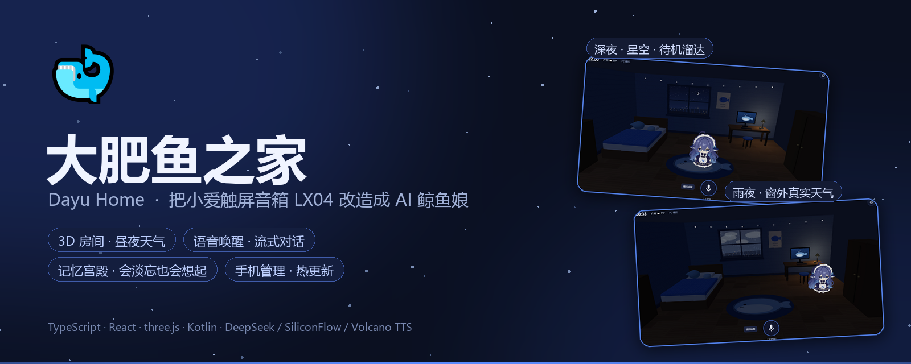

# 🐋 Dayu Home

**Turn a Xiaomi XiaoAI Touch Speaker (LX04) into a home for "Dayu" — an AI whale-girl living in a cozy blue room.**

She wanders around her room, watches the rain outside her window, listens when you talk, and remembers everything you tell her — then slowly forgets, just like a person would.

**English** · [简体中文](README.md)

[](https://github.com/jio-demon/xiaoai-dayu-home/releases)
[](LICENSE)
[](https://nodejs.org)
[](https://www.typescriptlang.org/)
[](#-development--validation)
[](#-running-on-real-hardware-lx04)

[✨ Features](#-features) · [🚀 Quick Start](#-quick-start-pc-simulation-no-hardware-needed) · [📖 Illustrated Tutorial](docs/tutorial.en.md) · [🏗️ Architecture](#️-architecture) · [🧠 Memory Palace](#-memory-palace-how-she-remembers-you) · [🔧 Real Hardware](#-running-on-real-hardware-lx04) · [❓ FAQ](#-faq)

</div>

> ℹ️ The app UI and wake word are Chinese-first (wake word: 「大肥鱼」 *dà féi yú*, "big fat fish"). Docs are bilingual; deeper engineering notes are in Chinese with links below.

---

## 📸 See It First

<div align="center">
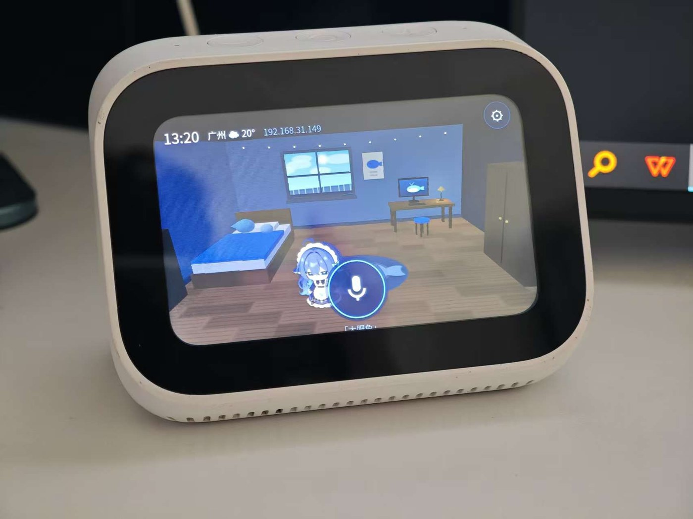
<br><sub>🐋 <b>Real hardware</b>: a converted XiaoAI Touch Speaker LX04 — Guangzhou ☁️ 20°, sunny afternoon, Dayu waiting on her whale rug for the wake word (offline on-device KWS, smooth on 1GB RAM)</sub>
</div>

<br>

<table>
<tr>
<td width="50%">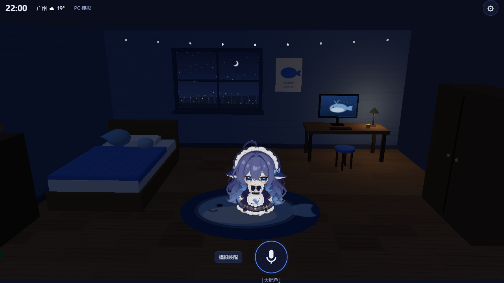<br><sub>🌙 Late night: stars, moon, city lights — she zones out on the whale rug</sub></td>
<td width="50%">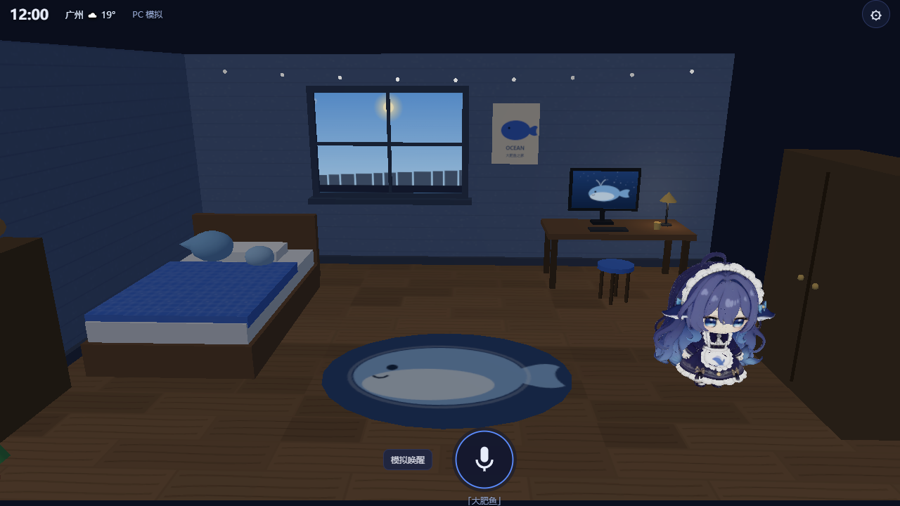<br><sub>☀️ Daytime: the sky outside follows local time; the sun crosses the sky</sub></td>
</tr>
<tr>
<td>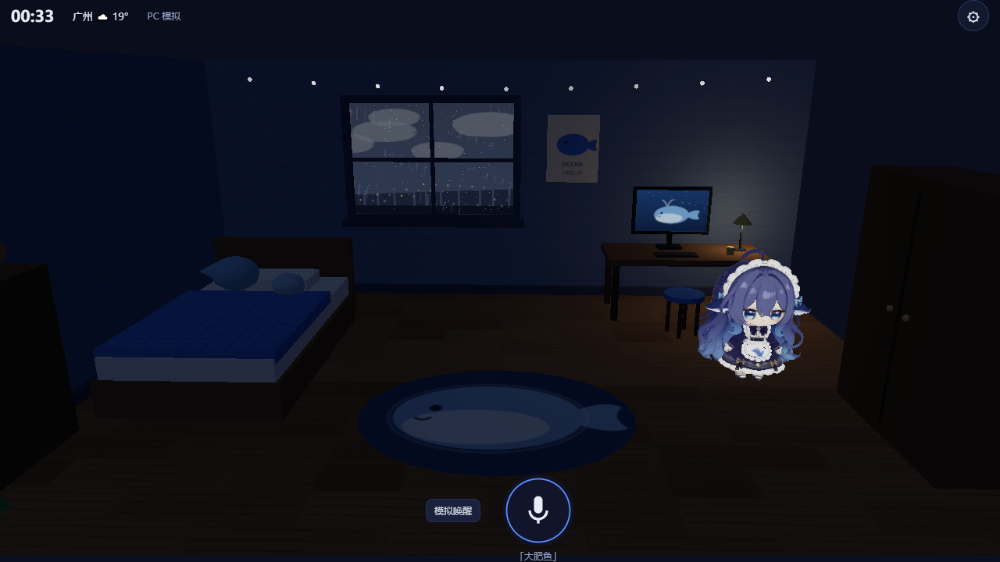<br><sub>🌧️ Set your city: when it rains in Guangzhou, it rains outside her window (the desk lamp glows a bit brighter)</sub></td>
<td>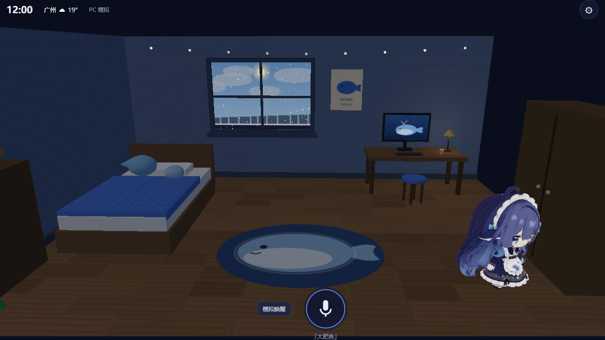<br><sub>❄️ Snow falls, thunderstorms flash, overcast turns grey, fog gets hazy</sub></td>
</tr>
<tr>
<td>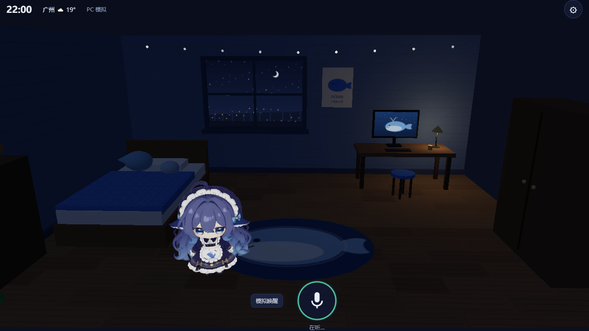<br><sub>🎤 Say the wake word and she trots up to the camera, stands still and listens</sub></td>
<td>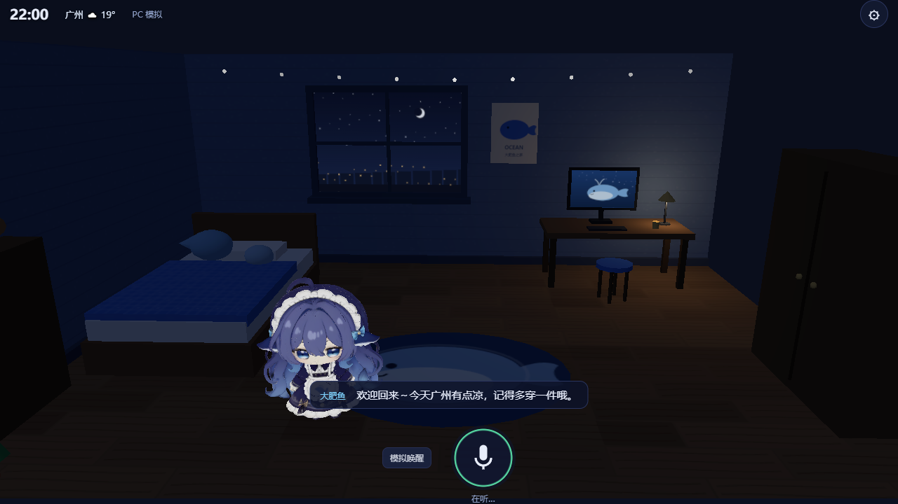<br><sub>💬 Streaming answers spoken sentence by sentence; subtitles toggleable; tap the mic mid-speech to interrupt</sub></td>
</tr>
<tr>
<td>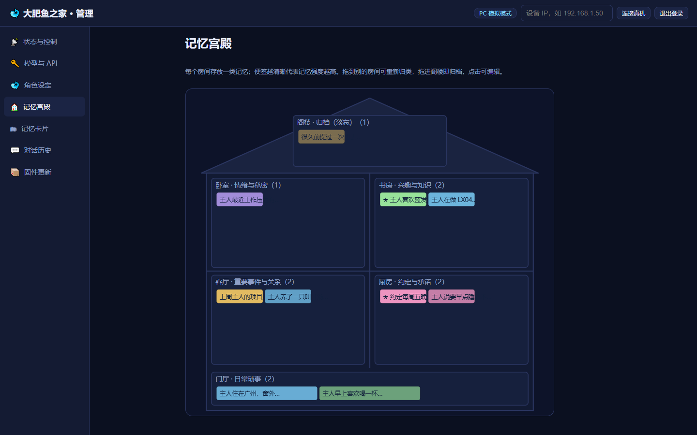<br><sub>🏠 Phone admin page: memory-palace cutaway — clearer sticky notes = stronger memories; drag to reorganize</sub></td>
<td>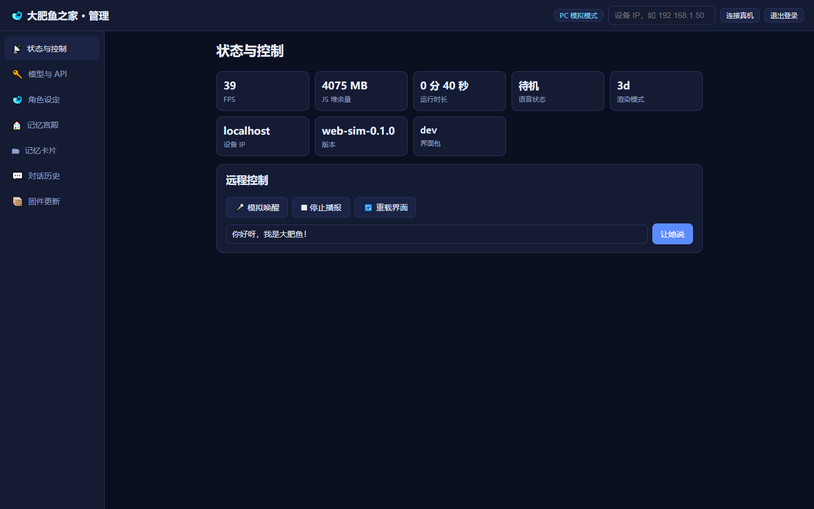<br><sub>📱 Status & control: FPS / RAM / uptime; make her speak or reload the UI remotely</sub></td>
</tr>
</table>

> Except for the first real-hardware photo, all screenshots come from PC simulation mode (`npm run dev`) — pixel-identical to the device UI. Generator script: [`tools/docs-screenshots.mjs`](tools/docs-screenshots.mjs).

---

## ✨ Features

| | Feature | Details |
|---|---|---|
| 🏠 | **Living 3D scene** | Procedural low-poly room in three.js + a chibi whale-girl GLB generated by Tencent Hunyuan 3D (11MB, decimated). She wanders when idle, avoids furniture, looks around; on wake she trots to the camera and faces you. Tap her for a head-pat hop; tap the window / bed / plushie / monitor / lamp / rug / radio / plant for easter-egg lines. |
| 🌦️ | **Day-night cycle & real weather** | The sky outside follows local time (sunrise/sunset gradients, sun & moon paths, stars and city lights at night). Set a city and the window shows its real rain / snow / clear / thunder (Tencent Weather for China, key-free; Open-Meteo internationally). |
| 🎙️ | **Wake-word voice chat** | On-device: sherpa-onnx local KWS → VAD recording → SenseVoice ASR → DeepSeek streaming LLM → sentence-by-sentence TTS, interruptible anytime. PC simulation offers a "simulate wake" button and experimental browser wake word. |
| 🧠 | **Memory palace** | Six rooms categorize memory cards; semantic recall topK≤6 within ≤800 tokens; frequently recalled memories sharpen, neglected ones fade into the attic; pinned memories never fade; nightly 4am decay / merge / archive. |
| 📱 | **Phone admin page** | Scan the QR code → `http://<device-ip>:8080/#/admin`: masked API keys, per-item connectivity tests, persona editor, memory palace, chat history, status control, hot updates. |
| 🔥 | **UI hot updates** | Web-only changes need no APK reflash: upload a zip in the admin page → sha256 verify → switch → 30s watchdog auto-rollback if the new bundle fails to report; keeps the last 3 bundles. |
| 🐢 | **Old-hardware friendly** | Build target Chrome 64 + legacy dual bundle for the LX04's WebView 61; sustained FPS < 20 auto-degrades to 2.5D (baked background + sprites), measured ~41fps on device. |
| 🔒 | **Privacy first** | Keys stay on-device (Android Keystore AES/GCM); the admin page only ever sees masks; admin password stored as sha256; no third-party server relays your conversations. |
| 🖥️ | **Full PC simulation** | No hardware needed: `npm run dev` gives you everything, two tabs synced live, built-in cloud proxy solves browser CORS. |

---

## 🚀 Quick Start (PC simulation, no hardware needed)

**Prerequisite**: Node.js ≥ 20 (verified on v24). In mainland China, add `--registry=https://registry.npmmirror.com` to npm commands.

```powershell
git clone https://github.com/jio-demon/xiaoai-dayu-home.git
cd xiaoai-dayu-home
npm install --registry=https://registry.npmmirror.com   # omit the registry flag outside China
npm run dev
```

Open two browser tabs:

| URL | What it is |
|---|---|
| `http://localhost:5173/#/device` | 🐋 Device page: 3D room, voice ring, subtitles, ⚙ settings |
| `http://localhost:5173/#/admin` | 📱 Admin page: API keys, persona, memories (synced live with the device tab) |

**Three steps for first use:**

1. Device page top-right **⚙ → set an admin password** (≥4 chars).
2. Log into the admin page with it → **Models & API**: enter a DeepSeek key (chat) and a SiliconFlow key (ASR / TTS / embeddings — one key, three fields) → click **"Connectivity test"** on each card until you see a green ✓.
3. Back on the device page, click **"Simulate wake"** or the mic ring and talk to your computer. No keys? Still fun: the room, weather, touch easter eggs and memory-palace UI all work.

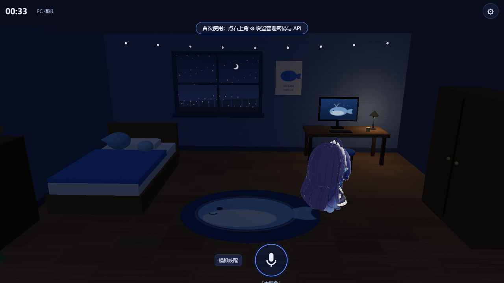

> 💡 Every step with screenshots: **[📖 Illustrated Tutorial](docs/tutorial.en.md)** · dev details: [docs/dev-setup.md](docs/dev-setup.md) (Chinese).

---

## 🏗️ Architecture

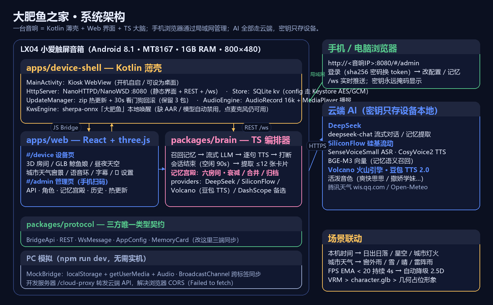

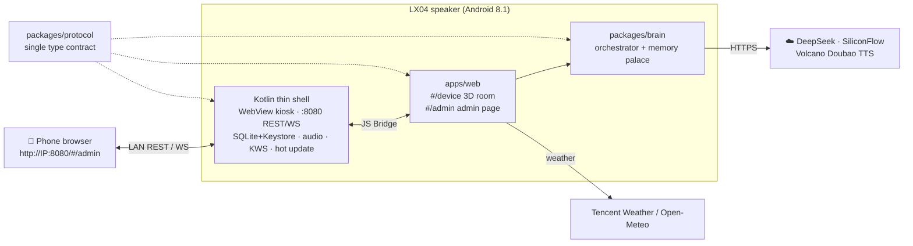

| Directory | Responsibility |
|---|---|
| [`packages/protocol`](packages/protocol) | The single type contract for all three sides: `BridgeApi` / REST / `WsMessage` / `AppConfig` / `MemoryCard` |
| [`packages/brain`](packages/brain) | Conversation orchestration (recall → streaming LLM → per-sentence TTS → session consolidation → nightly maintenance) + memory palace + cloud provider adapters · **52 unit tests** |
| [`apps/web`](apps/web) | React device page + admin page + three.js scene / weather / locomotion / degradation · **40 unit tests** |
| [`apps/device-shell`](apps/device-shell) | Kotlin thin shell: kiosk WebView, NanoHTTPD/NanoWSD :8080, SQLite kv (Keystore-encrypted), AudioRecord/MediaPlayer, sherpa-onnx KWS, zip hot updates |
| [`tools/`](tools) | Flashing backup / model download / Blender asset pipeline / E2E scripts / screenshot generator |

Data flow in one breath:

- 🎙️ Voice: wake → VAD record → ASR → streaming LLM sentence splitter → cloud TTS → queued playback; tapping the mic mid-speech = interrupt.
- 🧠 Memory: 90s idle ends a session → LLM extracts ≤12 atomic cards into six rooms → embed; recall by score during chat; 4am consolidation.
- 📱 Admin: phone → REST login (sha256 password → token) → edit config/memories → `/ws` pushes to the device page live; device status reported every 5s.
- 🖥️ PC sim: MockBridge (localStorage / getUserMedia / Audio) + BroadcastChannel cross-tab sync; cloud calls forwarded via the dev server's `/cloud-proxy/<host[:port]>/<path>` to avoid CORS.

Details: [docs/architecture.md](docs/architecture.md) (Chinese).

---

## 🧠 Memory Palace: How She Remembers You

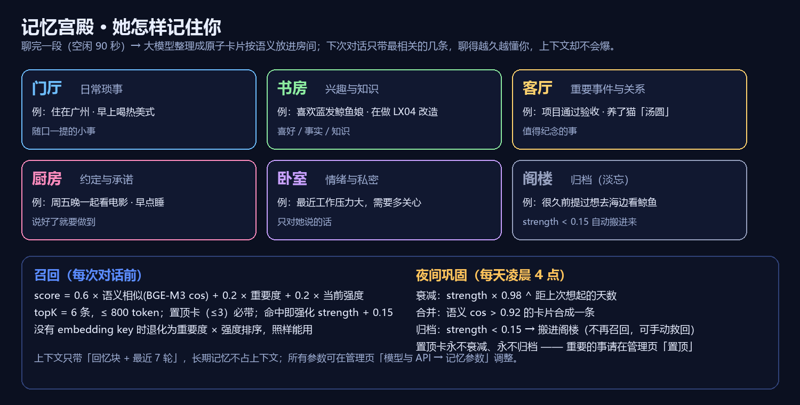

| Room | Stores | Examples |
|---|---|---|
| 🚪 Foyer | Daily facts | "Owner lives in Guangzhou", "likes hot americano in the morning" |
| 📚 Study | Interests & knowledge | "likes blue-haired whale girls", "working on an LX04 mod project" |
| 🛋️ Living room | Events & relationships | "the project passed review", "has a cat named Tangyuan" |
| 🍳 Kitchen | Promises & plans | "movie night on Friday", "said they'd sleep earlier" |
| 🛏️ Bedroom | Emotions & private | "work has been stressful lately" |
| 📦 Attic | Archived (faded) | Memories with strength < 0.15 move here automatically; no longer recalled, but rescuable |

- **Recall score** = `0.6 × semantic similarity (BGE-M3) + 0.2 × importance + 0.2 × current strength`; topK 6, ≤800 tokens; pinned cards (≤3) always included; each hit reinforces `+0.15`.
- **Nightly consolidation** (4am daily): `strength × 0.98^days` decay → merge same-room same-type cards with cos > 0.92 → archive weak memories.
- Context carries only a "recall block + last 7 turns" — long-term memory never bloats the prompt. Without an embedding key, recall degrades gracefully to importance ordering.
- In the admin page you can **drag sticky notes between rooms**, drop them into the attic, click to edit, pin, or create memories manually.

<table>
<tr>
<td width="50%"><br><sub>Cutaway view: note clarity = memory strength, ★ = pinned</sub></td>
<td width="50%">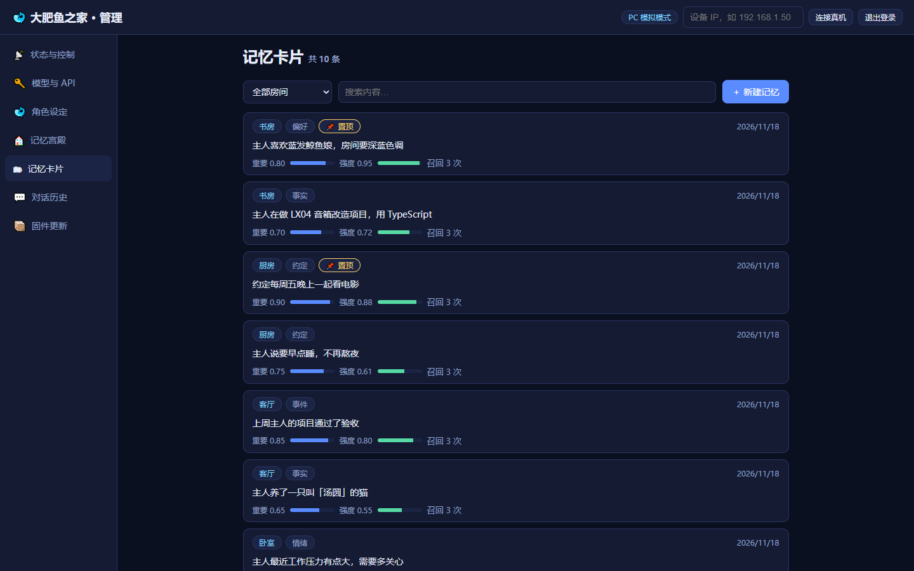<br><sub>Card list: importance / strength / recall count, filterable & searchable</sub></td>
</tr>
</table>

---

## 🔧 Running on Real Hardware (LX04)

> ⚠️ **Flashing carries risk — always back up `proinfo` / `nvram` / `nvdata` first!** Full guide & field notes: [docs/flashing.md](docs/flashing.md) (Chinese).

**Hardware**: Xiaomi XiaoAI Touch Speaker LX04 · MTK MT8167 (4×A53) · 1GB RAM · 800×480 · Android 8.1 · WebView Chrome 61.

### Route A: ADB already available → install the APK directly (try this first)

Download `dayu-home-v0.1.0.apk` (~38MB, includes the local wake-word model) from [Releases](https://github.com/jio-demon/xiaoai-dayu-home/releases):

```powershell
adb install -r dayu-home-v0.1.0.apk
adb shell am start -n com.xiaoai.shell/.MainActivity
# Boot straight into Dayu (set as home launcher):
adb shell cmd package set-home-activity com.xiaoai.shell/.MainActivity
# Uninstall to restore the original system:
adb uninstall com.xiaoai.shell
```

Allow the microphone permission on first launch; scan the QR code in ⚙ settings from your phone to open the admin page and enter keys.

### Route B: stock firmware → flash a community ROM

1. [docs/flashing.md](docs/flashing.md): MTK drivers / BROM mode / **backup** / flash the Hikaru community ROM / ADB.
2. [tools/stage0/checklist.md](tools/stage0/checklist.md): G1–G4 hardware acceptance gates (backup, WebView performance, voice pipeline, end-to-end latency).
3. [docs/user-manual.md](docs/user-manual.md): Wi-Fi setup, keys, daily use.

### Build the APK yourself

```powershell
# 1. Fetch local wake models (sherpa-onnx KWS + silero VAD, ~10MB)
powershell -File tools\stage0\fetch-models.ps1
# 2. Put the sherpa-onnx Android AAR into apps\device-shell\app\libs\ (see device-shell/README)
# 3. Build (needs JDK17 + Android SDK 34 + Gradle 8.7; the script runs npm run build and copies dist)
powershell -File apps\device-shell\build-apk.ps1
```

Output: `release/dayu-home-v0.1.0.apk`. Missing AAR/models simply disables KWS — tap-to-talk still works.

### Web-only changes? Hot-update instead

`npm run build` → zip the **contents** of `apps/web/dist` (`index.html` at the zip root) → upload in admin "Firmware update" → auto-reload; if the new bundle doesn't report within 30s, automatic rollback.

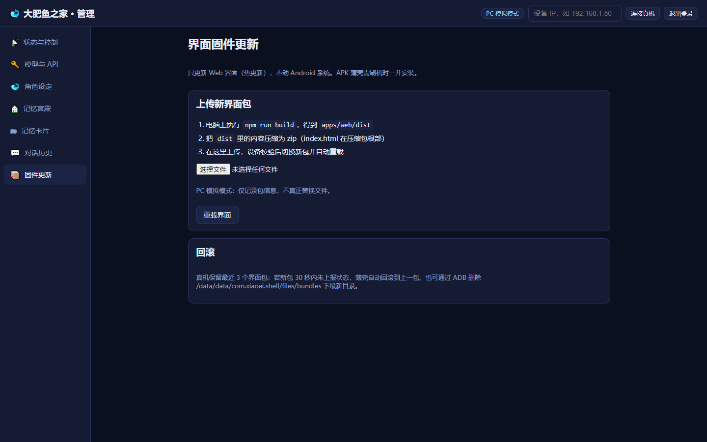

---

## ☁️ Cloud Services & Keys

| Purpose | Recommended | Where to get a key | Notes |
|---|---|---|---|
| Chat LLM | DeepSeek `deepseek-chat` | [platform.deepseek.com](https://platform.deepseek.com) | Required; cheap pay-as-you-go |
| ASR | SiliconFlow `SenseVoiceSmall` | [cloud.siliconflow.cn](https://cloud.siliconflow.cn) | One key covers ASR / TTS / embeddings |
| TTS | SiliconFlow `CosyVoice2-0.5B`; **Volcano Doubao TTS 2.0 recommended** (livelier) | [console.volcengine.com](https://console.volcengine.com/speech/new/setting/activate?projectName=default) | Doubao 2.0 has a free trial quota; activation steps in the [user manual](docs/user-manual.md#常见问题) (Chinese) |
| Embeddings | SiliconFlow `BAAI/bge-m3` | Same as above | Optional — recall falls back to importance ordering |
| Weather | Tencent Weather wis.qq.com (China) / Open-Meteo (international) | No key needed | Refreshes every 10 min |

- Keys are **stored on-device only** (AES/GCM via Android Keystore on real hardware); the admin page always shows masks (`sk-1****abcd` = unchanged).
- Every config card has a **"Connectivity test"**: sends one real minimal request and shows latency plus the exact error (401 = invalid key / timeout = network unreachable).

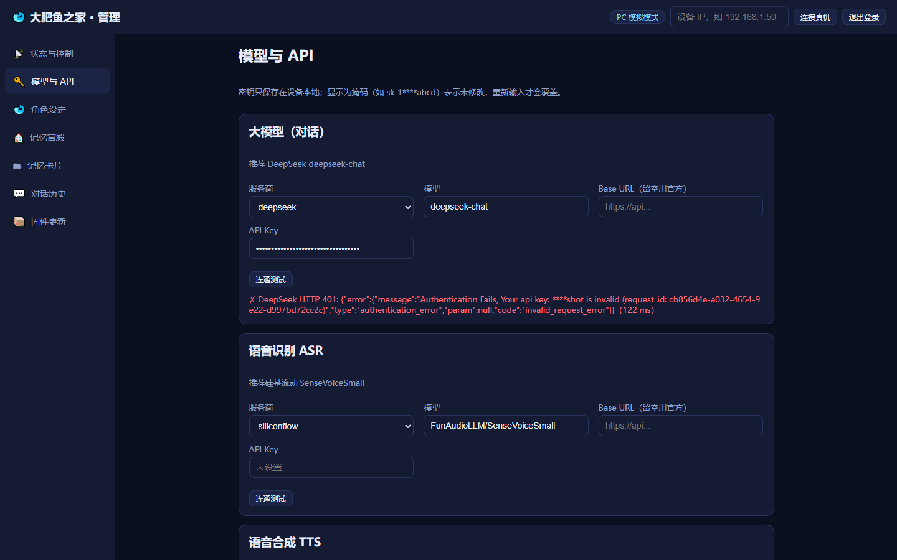

---

## 🧪 Development & Validation

```powershell
npm run typecheck   # protocol + brain + web
npm run test        # brain 52 + web 40 cases (vitest)
npm run build       # vite target chrome64 + @vitejs/plugin-legacy dual bundle for old WebViews
```

Optional E2E regression (run `npm run dev` first; needs local Playwright Chromium):

```powershell
node tools/e2e-smoke.mjs        # init → admin password → 4 connectivity tests → proxy chain
node tools/e2e-voice.mjs        # wake → record → VAD → ASR full chain
node tools/e2e-wake-hit.mjs     # homophone wake-word hit
node tools/docs-screenshots.mjs # regenerate every screenshot in this README
```

**Dependency notes**
- `@pixiv/three-vrm` pinned to **2.1.0** (2.1.1+ needs three ≥ 0.162; this project stays on three 0.160 to keep WebGL1 for the old Mali GPU).
- Build target is chrome64 — do not raise it; the LX04's WebView 61 automatically loads the SystemJS legacy bundle.
- Character model priority: **VRM > `character.glb` > geometric placeholder**; swapping models / real facial expressions: [docs/assets.md](docs/assets.md).

---

## 📚 Documentation Index

| Doc | Contents | Language |
|---|---|---|
| **[📖 Illustrated Tutorial](docs/tutorial.en.md)** | Install → real hardware, every step with screenshots | EN |
| [图文使用教程](docs/tutorial.md) | Same tutorial in Chinese | 中文 |
| [docs/user-manual.md](docs/user-manual.md) | User manual: first boot, daily interaction, weather, admin, FAQ | 中文 |
| [docs/dev-setup.md](docs/dev-setup.md) | Dev environment, cloud proxy, browser wake word, E2E | 中文 |
| [docs/architecture.md](docs/architecture.md) | Architecture, data flow, degradation & reliability | 中文 |
| [docs/flashing.md](docs/flashing.md) | LX04 flashing guide + field notes | 中文 |
| [docs/assets.md](docs/assets.md) | Character/room assets: GLB pipeline, VRM, Blender baking | 中文 |
| [apps/device-shell/README.md](apps/device-shell/README.md) | Kotlin shell build & runtime structure | 中文 |
| [tools/stage0/checklist.md](tools/stage0/checklist.md) | G1–G4 hardware acceptance checklist | 中文 |

---

## ❓ FAQ

<details>
<summary><b>"Failed to fetch" / LLM call fails</b></summary>

Usually not a bad key. In PC simulation the browser's direct cloud calls get blocked by CORS; this project ships a dev proxy that forwards automatically — just refresh the page. Still failing? Run the per-item "Connectivity test" in the admin page: `HTTP 401` = invalid key or insufficient balance; `timeout` = network unreachable.
</details>

<details>
<summary><b>Wake word doesn't trigger on PC</b></summary>

PC browsers have no real wake engine by default: use the "Simulate wake" button or tap the mic ring; or enable ⚙ → "Web speech wake (experimental)" (Chrome/Edge, allow the mic; Chrome relies on Google's speech service — in mainland China prefer Edge). On real hardware the native sherpa-onnx KWS handles it; quiet room, within 1 meter works best.
</details>

<details>
<summary><b>Voice sounds robotic — want a livelier tone</b></summary>

Admin → Models & API → TTS provider **volcano (Doubao TTS 2.0)**, voices "爽快思思 2.0" / "撒娇学妹 2.0". Trial activation and API-key steps in the [user manual](docs/user-manual.md) (Chinese).
</details>

<details>
<summary><b>Choppy rendering</b></summary>

Sustained FPS < 20 auto-degrades to 2.5D; you can also lock the render mode in ⚙ settings. Measured ~41fps in 2.5D on the LX04.
</details>

<details>
<summary><b>Forgot the admin password</b></summary>

Debug builds can reset via ADB (loses API config): `adb shell "run-as com.xiaoai.shell rm databases/xiaoai.db"`. In PC simulation, clear the browser's localStorage.
</details>

<details>
<summary><b>UI still old after reinstalling the APK</b></summary>

If SQLite already holds a hot-update bundle pointer, it takes priority; upload a fresh zip via the admin page or clear the old pointer. See the field notes in [docs/flashing.md](docs/flashing.md).
</details>

---

## 📄 License

[MIT](LICENSE) © 2026 jio-demon

Character model generated by Tencent Hunyuan 3D and post-processed. This project is not affiliated with Xiaomi / Tencent / DeepSeek / SiliconFlow / Volcano Engine. Flashing carries risk — evaluate carefully and back up first.

<div align="center"><sub>🐋 "Surface and take a breath." — Dayu</sub></div>