<div align="center">

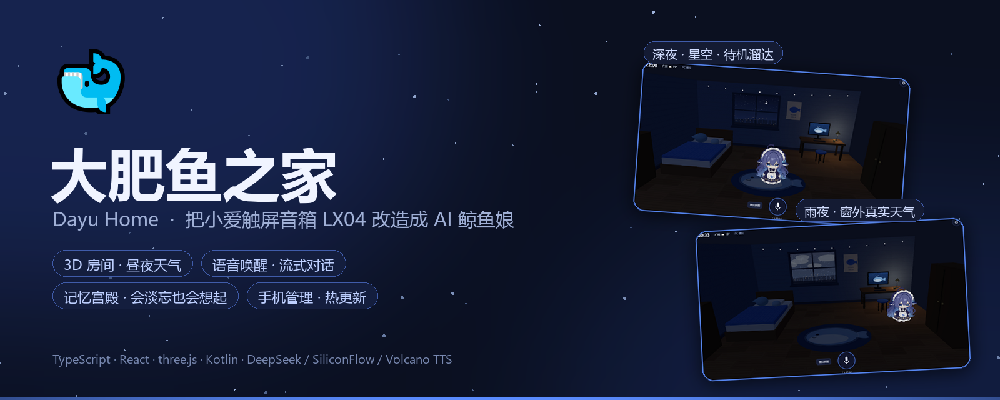

# 🐋 大肥鱼之家 · Dayu Home

**把小米小爱触屏音箱 LX04，改造成住在蓝色小房间里的 AI 鲸鱼娘「大肥鱼」。**

她会自己在房间里溜达、看窗外的雨、听你说话、记得你说过的每一件事——也会像人一样慢慢淡忘。

**简体中文** · [English](README.en.md)

[](https://github.com/jio-demon/xiaoai-dayu-home/releases)
[](LICENSE)
[](https://nodejs.org)
[](https://www.typescriptlang.org/)
[](#-开发与校验)
[](#-实机改造lx04)

[✨ 功能亮点](#-功能亮点) · [🚀 五分钟跑起来](#-五分钟跑起来pc-模拟无需实机) · [📖 图文使用教程](docs/tutorial.md) · [🏗️ 架构](#️-架构) · [🧠 记忆宫殿](#-记忆宫殿她怎样记住你) · [🔧 实机改造](#-实机改造lx04) · [❓ FAQ](#-常见问题)

</div>

---

## 📸 先看效果

<div align="center">
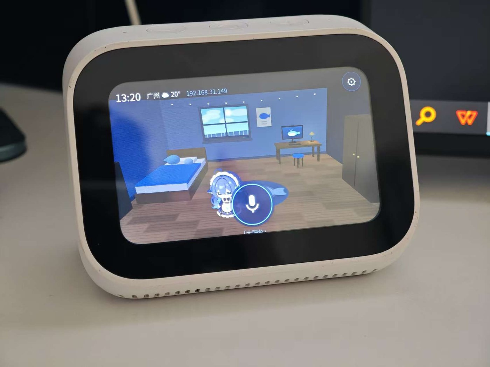
<br><sub>🐋 <b>真机实拍</b>：改造后的小爱触屏音箱 LX04 —— 广州 ☁️ 20°，午后晴天，大肥鱼在鲸鱼地毯上等你唤醒（本地 KWS 离线唤醒，1GB RAM 流畅运行）</sub>
</div>

<br>

<table>
<tr>
<td width="50%">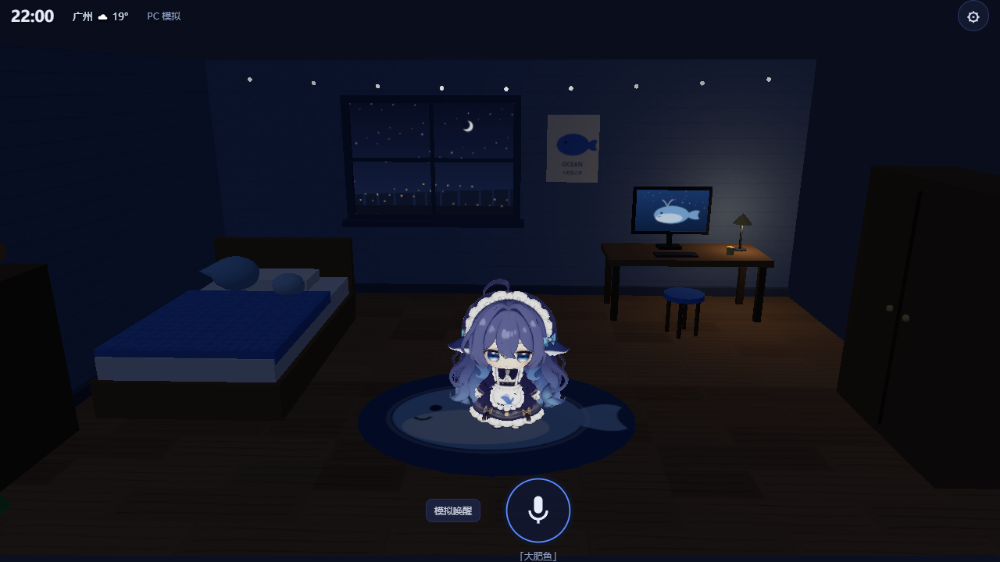<br><sub>🌙 深夜：星空、月亮、城市灯火，她在鲸鱼地毯上发呆</sub></td>
<td width="50%">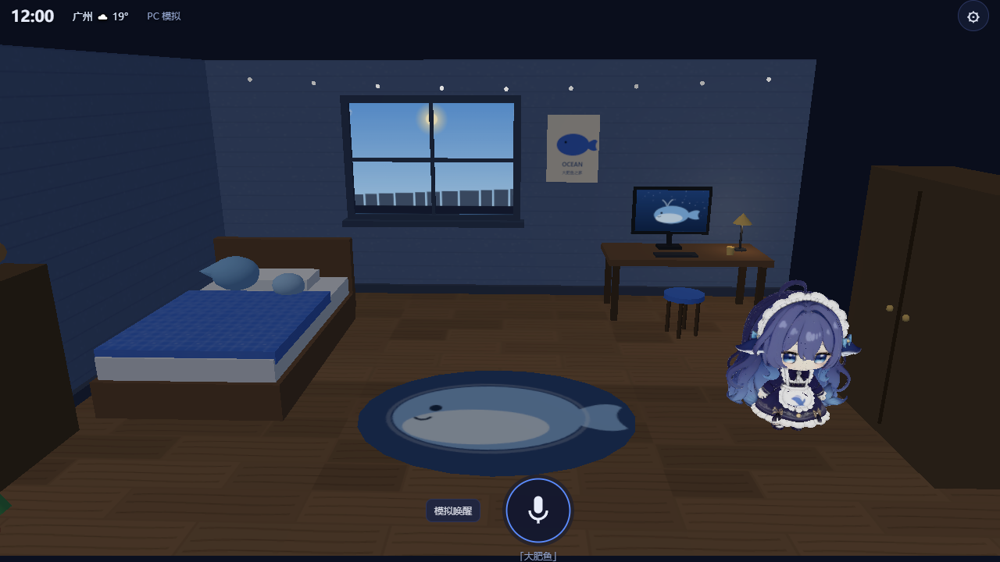<br><sub>☀️ 白天：窗外天色跟随本机时间，太阳会走过天空</sub></td>
</tr>
<tr>
<td>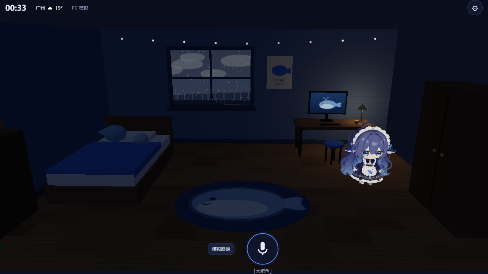<br><sub>🌧️ 设置城市后，广州下雨她的窗外就下雨（台灯还会自动亮一点）</sub></td>
<td>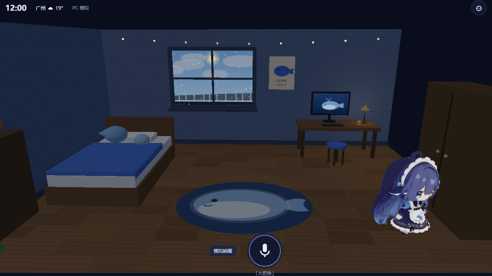<br><sub>❄️ 下雪飘雪、雷阵雨偶有闪电、阴天灰蒙、雾天朦胧</sub></td>
</tr>
<tr>
<td>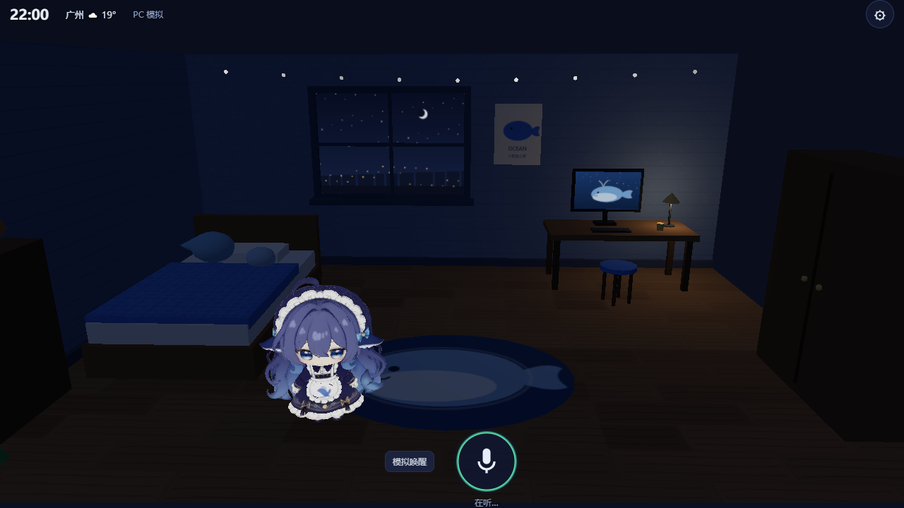<br><sub>🎤 说「大肥鱼」唤醒，她会小跑到镜头前站定听你说话</sub></td>
<td>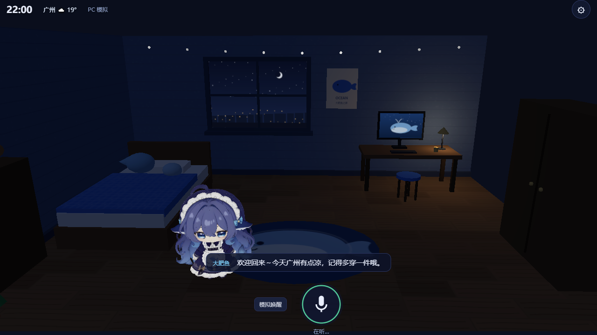<br><sub>💬 流式回答逐句播报，字幕可开关；说话中点麦克风即可打断</sub></td>
</tr>
<tr>
<td>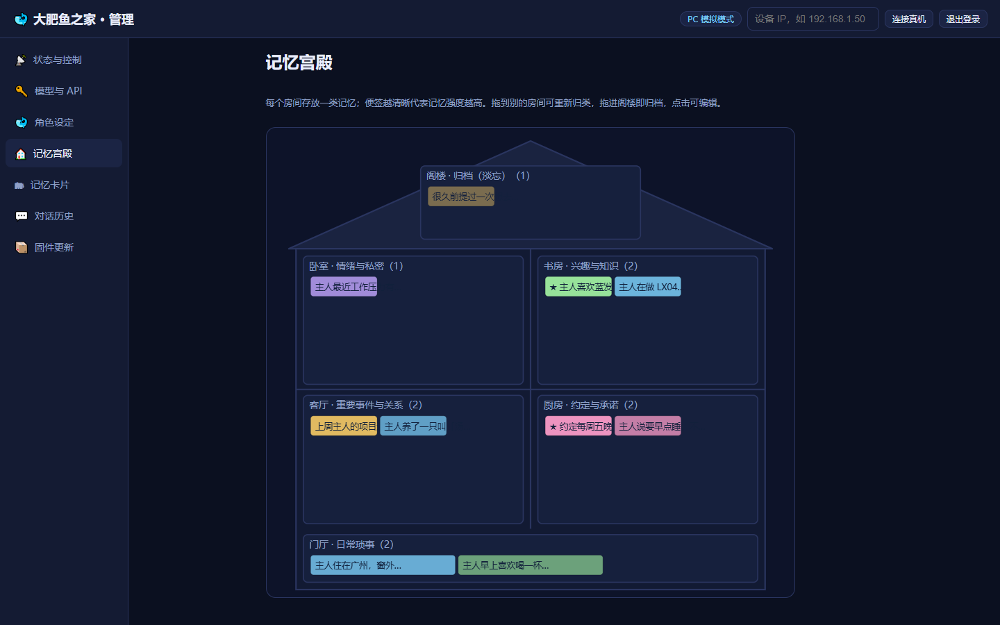<br><sub>🏠 手机管理页：记忆宫殿剖面图，便签越清晰记忆越强，可拖拽归类</sub></td>
<td>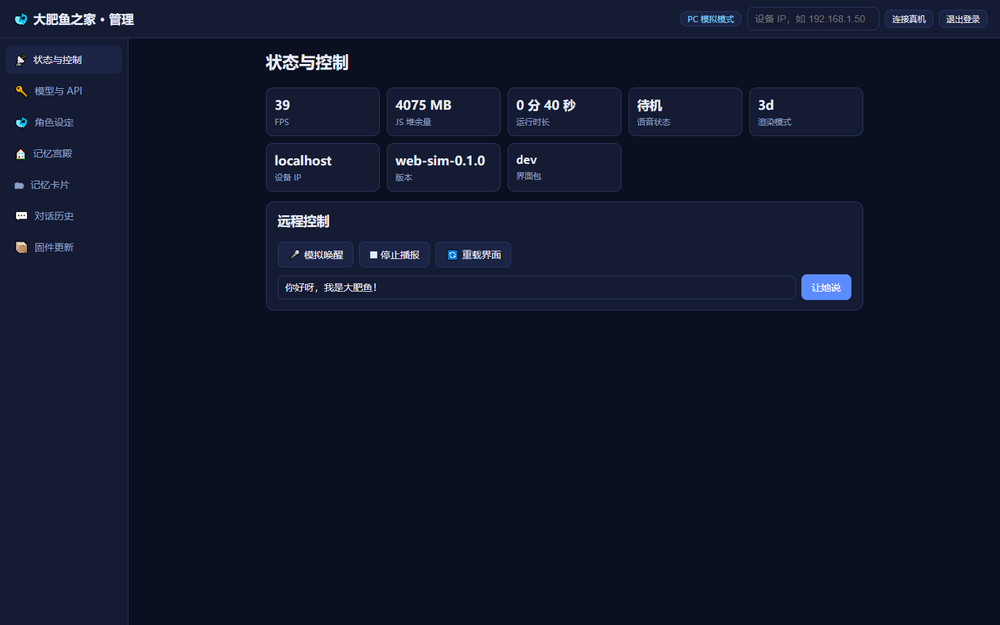<br><sub>📱 状态与控制：FPS / 内存 / 运行时长，远程让她说话、重载界面</sub></td>
</tr>
</table>

> 除首张真机实拍外，其余截图来自 PC 模拟模式（`npm run dev`），与实机界面完全一致。生成脚本：[`tools/docs-screenshots.mjs`](tools/docs-screenshots.mjs)。

---

## ✨ 功能亮点

| | 功能 | 说明 |
|---|---|---|
| 🏠 | **3D 生活场景** | three.js 程序化低模房间 + 腾讯混元生成的 Q 版鲸鱼娘 GLB（11MB，已减面优化）。待机随机溜达、避家具、发呆东张西望；唤醒后小跑到镜头前面向你。点她摸头会蹦一下，点窗户 / 床 / 玩偶 / 显示器 / 灯 / 地毯 / 收音机 / 绿植都有彩蛋台词。 |
| 🌦️ | **昼夜与真实天气** | 窗外天色跟随本机时间（日出日落渐变、太阳月亮轨迹、夜晚星空与城市灯火）；设置城市后窗外下真实的雨 / 雪 / 晴 / 雷（国内腾讯天气免 key，国际 Open-Meteo）。 |
| 🎙️ | **语音唤醒对话** | 实机 sherpa-onnx 本地唤醒「大肥鱼」→ VAD 录音 → SenseVoice ASR → DeepSeek 流式 LLM → 逐句 TTS 播报，支持随时打断。PC 模拟有「模拟唤醒」按钮和实验性网页语音唤醒。 |
| 🧠 | **记忆宫殿** | 六个房间分类存放记忆卡片；语义召回 topK≤6、≤800 token；常想起的越来越清晰，久不提的慢慢淡忘进阁楼；重要的事置顶永不遗忘；每天凌晨 4 点自动衰减 / 合并 / 归档。 |
| 📱 | **手机管理页** | 扫码进 `http://音响IP:8080/#/admin`：API 密钥（掩码显示）、逐项连通测试、角色设定、记忆宫殿、对话历史、状态控制、界面热更新。 |
| 🔥 | **界面热更新** | 只改 Web 不用重刷 APK：管理页上传 zip → sha256 校验 → 切包 → 30s 看门狗未上报新包自动回滚，保留最近 3 包。 |
| 🐢 | **老硬件友好** | 目标 Chrome 64 + legacy 双包兼容 LX04 的 WebView 61；FPS 持续低于 20 自动降级 2.5D（烘焙背景 + 精灵），实测 ~41fps。 |
| 🔒 | **隐私优先** | 密钥只存设备本地（Android Keystore AES/GCM），管理端永远掩码；管理密码只存 sha256；没有第三方服务器中转你的对话。 |
| 🖥️ | **PC 完整模拟** | 无需实机：`npm run dev` 即可体验全部功能，两个标签页实时同步，内置云端代理解决浏览器跨域。 |

---

## 🚀 五分钟跑起来（PC 模拟，无需实机）

**前置**：Node.js ≥ 20（本仓库在 v24 验证）。国内网络请给所有 npm 命令加 `--registry=https://registry.npmmirror.com`。

```powershell
git clone https://github.com/jio-demon/xiaoai-dayu-home.git
cd xiaoai-dayu-home
npm install --registry=https://registry.npmmirror.com
npm run dev
```

浏览器打开两个标签页：

| 地址 | 是什么 |
|---|---|
| `http://localhost:5173/#/device` | 🐋 设备页：3D 房间、语音环、字幕、⚙ 设置 |
| `http://localhost:5173/#/admin` | 📱 管理页：填 API Key、改角色、看记忆（与设备页实时同步） |

**第一次使用的三步：**

1. 设备页右上角 **⚙ → 设置管理密码**（≥4 位）。
2. 管理页用该密码登录 → **模型与 API** 填入 DeepSeek Key（对话）和硅基流动 Key（ASR / TTS / 向量，一个 key 填三处）→ 每项点 **「连通测试」** 看到绿色 ✓。
3. 回到设备页点 **「模拟唤醒」** 或麦克风圆环，对着电脑说话即可。没有 Key 也能玩：房间、天气、触屏彩蛋、记忆宫殿 UI 都能体验。

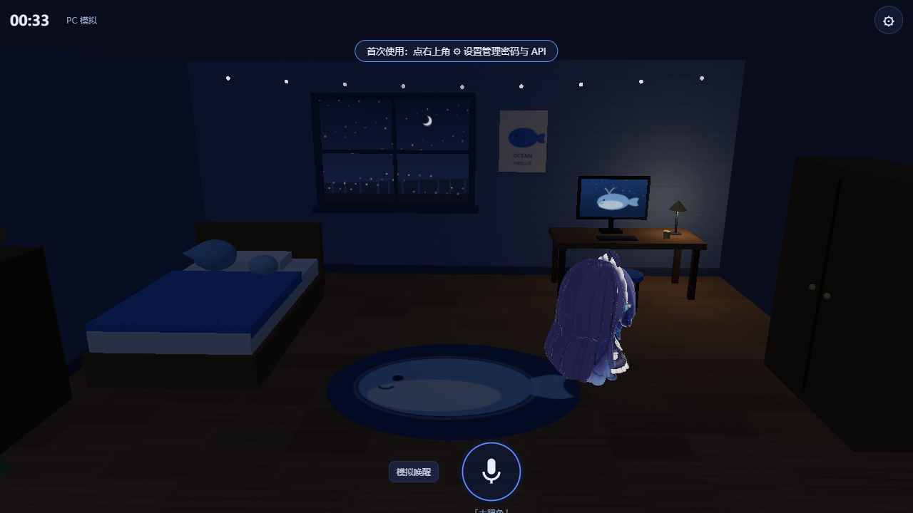

> 💡 更详细的每一步截图请看 **[📖 图文使用教程](docs/tutorial.md)**；开发细节见 [docs/dev-setup.md](docs/dev-setup.md)。

---

## 🏗️ 架构

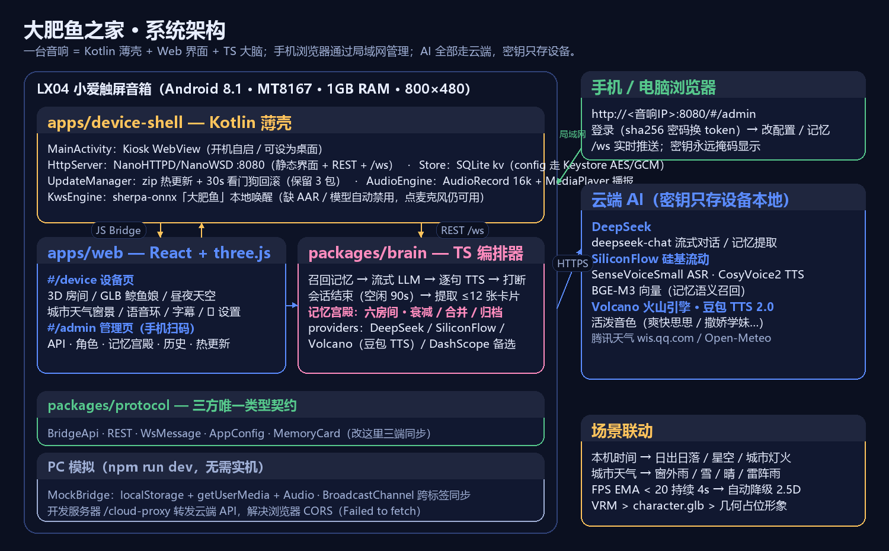

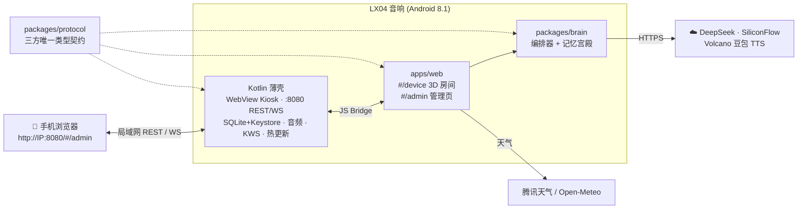

| 目录 | 职责 |
|---|---|
| [`packages/protocol`](packages/protocol) | 三方唯一类型契约：`BridgeApi` / REST / `WsMessage` / `AppConfig` / `MemoryCard`（改这里三端同步） |
| [`packages/brain`](packages/brain) | 对话编排（召回 → 流式 LLM → 逐句 TTS → 会话整理 → 夜间巩固）+ 记忆宫殿 + 云服务商适配 · **52 单测** |
| [`apps/web`](apps/web) | React 设备页 + 管理页 + three.js 场景 / 天气 /  locomotion / 降级 · **40 单测** |
| [`apps/device-shell`](apps/device-shell) | Kotlin 薄壳：Kiosk WebView、NanoHTTPD/NanoWSD :8080、SQLite kv（Keystore 加密）、AudioRecord/MediaPlayer、sherpa-onnx KWS、zip 热更新 |
| [`tools/`](tools) | 刷机备份 / 模型下载 / Blender 素材脚本 / E2E 回归 / 文档截图与配图生成 |
| [`docs/`](docs) | 架构、开发、刷机、素材、手册、Stage0 门槛、**图文教程** |

**关键数据流**

- 🎙️ 语音：KWS 命中 → `startMic(record)` → VAD 截断（静音 0.7s / 最长 15s）→ 云端 ASR → 流式 LLM 逐句 → 云端 TTS → 队列播报；说话中再点麦克风 = 打断。
- 🧠 记忆：空闲 90s 结束会话 → LLM 提取 ≤12 张原子卡片入六房间 → 向量化；对话时按得分召回；凌晨 4 点巩固。
- 📱 管理：手机 → REST 登录（sha256 密码换 token）→ 改配置 / 记忆 → `/ws` 实时推给设备页；设备状态每 5s 上报。
- 🖥️ PC 模拟：MockBridge（localStorage / getUserMedia / Audio）+ BroadcastChannel 跨标签同步；云端请求走开发服务器 `/cloud-proxy/<host[:port]>/<path>` 转发，避免 CORS。

详见 [docs/architecture.md](docs/architecture.md)。

---

## 🧠 记忆宫殿：她怎样记住你

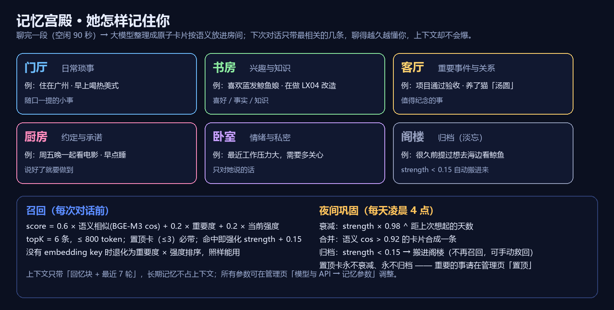

| 房间 | 存放 | 例子 |
|---|---|---|
| 🚪 门厅 | 日常琐事 | 「主人住在广州」「早上喜欢喝热美式」 |
| 📚 书房 | 兴趣与知识 | 「喜欢蓝发鲸鱼娘」「在做 LX04 改造项目」 |
| 🛋️ 客厅 | 重要事件与关系 | 「项目通过了验收」「养了一只叫汤圆的猫」 |
| 🍳 厨房 | 约定与承诺 | 「周五晚一起看电影」「说要早点睡」 |
| 🛏️ 卧室 | 情绪与私密 | 「最近工作压力有点大」 |
| 📦 阁楼 | 归档（淡忘） | 强度 < 0.15 的记忆自动搬进来，不再召回，可手动救回 |

- **召回得分** = `0.6 × 语义相似(BGE-M3) + 0.2 × 重要度 + 0.2 × 当前强度`；topK 6、≤800 token；置顶卡（≤3）必带；命中即强化 `+0.15`。
- **夜间巩固**（每天 4 点）：`strength × 0.98^天` 衰减 → 同房间同类型 cos > 0.92 合并 → 弱记忆归档。
- 上下文只带「回忆块 + 最近 7 轮」，长期记忆不占上下文；没有 embedding key 时退化为重要度排序，照样能用。
- 管理页可以 **拖拽便签重新归类**、拖进阁楼归档、点击编辑、置顶、手动新建记忆。

<table>
<tr>
<td width="50%"><br><sub>房子剖面图：便签清晰度 = 记忆强度，★ = 置顶</sub></td>
<td width="50%">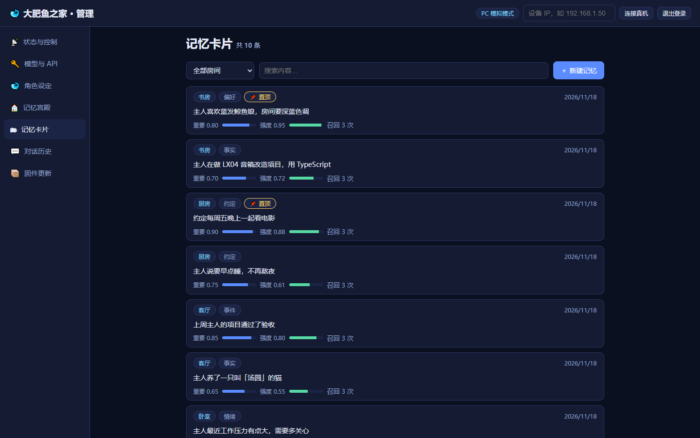<br><sub>卡片列表：重要度 / 强度 / 召回次数，可筛选搜索</sub></td>
</tr>
</table>

---

## 🔧 实机改造（LX04）

> ⚠️ **刷机有风险，第一步永远是备份 `proinfo` / `nvram` / `nvdata`！** 完整流程与踩坑记录见 [docs/flashing.md](docs/flashing.md)。

**硬件**：小米小爱触屏音箱 LX04 · MTK MT8167（4×A53）· 1GB RAM · 800×480 · Android 8.1 · WebView Chrome 61。

### 路线 A：已能开 ADB → 直接装 APK（推荐先试）

从 [Releases](https://github.com/jio-demon/xiaoai-dayu-home/releases) 下载 `dayu-home-v0.1.0.apk`（约 38MB，含本地唤醒模型）：

```powershell
adb install -r dayu-home-v0.1.0.apk
adb shell am start -n com.xiaoai.shell/.MainActivity
# 想开机直达大肥鱼桌面：
adb shell cmd package set-home-activity com.xiaoai.shell/.MainActivity
# 卸载回原样：
adb uninstall com.xiaoai.shell
```

首次启动允许麦克风权限；手机扫 ⚙ 设置里的二维码进管理页填 Key。

### 路线 B：原厂固件 → 刷机

1. [docs/flashing.md](docs/flashing.md)：MTK 驱动 / BROM 模式 / **备份** / 刷 Hikaru 官改 / ADB。
2. [tools/stage0/checklist.md](tools/stage0/checklist.md)：G1–G4 实机门槛逐项验证（备份、WebView 性能、语音链路、端到端时延）。
3. [docs/user-manual.md](docs/user-manual.md)：配网、填 Key、日常使用。

### 自己编译 APK

```powershell
# 1. 下载本地唤醒模型（sherpa-onnx KWS + silero VAD，约 10MB）
powershell -File tools\stage0\fetch-models.ps1
# 2. 放入 sherpa-onnx Android AAR 到 apps\device-shell\app\libs\（见 device-shell/README）
# 3. 构建（需 JDK17 + Android SDK 34 + Gradle 8.7；脚本会自动 npm run build 并复制 dist）
powershell -File apps\device-shell\build-apk.ps1
```

产物：`release/dayu-home-v0.1.0.apk`。缺 AAR / 模型时 KWS 自动禁用，点麦克风说话仍可用。

### 只改界面？热更新即可

`npm run build` → 把 `apps/web/dist` **里面的内容** 压成 zip（`index.html` 在压缩包根部）→ 管理页「固件更新」上传 → 自动重载；30s 内新包未上报状态自动回滚。

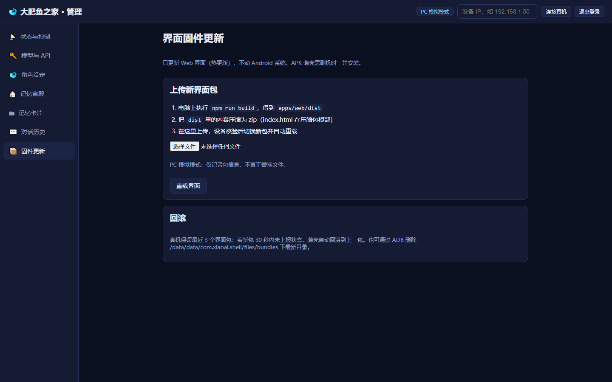

---

## ☁️ 云端服务与密钥

| 用途 | 默认服务商 / 模型 | 去哪申请 | 备注 |
|---|---|---|---|
| 对话 LLM | DeepSeek `deepseek-chat` | [platform.deepseek.com](https://platform.deepseek.com) | 任何 OpenAI 兼容网关都可：Base URL 填网关地址即可 |
| 语音识别 ASR | 硅基流动 `FunAudioLLM/SenseVoiceSmall` | [cloud.siliconflow.cn](https://cloud.siliconflow.cn) | 一个 key 同时用于 ASR / TTS / 向量 |
| 语音合成 TTS | 硅基流动 `CosyVoice2-0.5B`；**推荐火山豆包 TTS 2.0**（更活泼） | [console.volcengine.com](https://console.volcengine.com/speech/new/setting/activate?projectName=default) | 豆包 2.0 有免费试用额度；开通步骤见 [使用手册](docs/user-manual.md#常见问题) |
| 记忆向量 | 硅基流动 `BAAI/bge-m3` | 同上 | 不填也能用（召回退化为重要度排序） |
| 天气 | 腾讯天气 wis.qq.com（国内）/ Open-Meteo（国际） | 无需 key | 每 10 分钟刷新 |

- 密钥 **只保存在设备本地**（实机经 Android Keystore AES/GCM 加密落盘），管理页永远掩码显示（`sk-1****abcd` = 未修改）。
- 每项配置旁都有 **「连通测试」**：真实发一次最小请求，显示耗时与具体错误（401 = key 无效 / 超时 = 网络不通）。

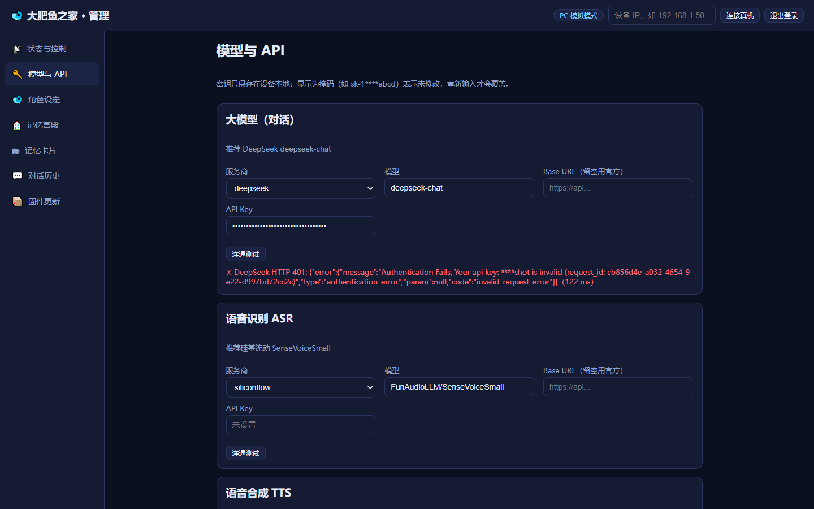

---

## 🧪 开发与校验

```powershell
npm run typecheck   # protocol + brain + web 三包
npm run test        # brain 52 例 + web 40 例（vitest）
npm run build       # vite 目标 chrome64 + @vitejs/plugin-legacy 双包，兼容旧 WebView
```

可选 E2E 回归（先 `npm run dev`，依赖本机 Playwright Chromium）：

```powershell
node tools/e2e-smoke.mjs        # 初始化 → 管理密码 → 四项连通测试 → 代理链路
node tools/e2e-voice.mjs        # 唤醒 → 录音 → VAD → ASR 全链路
node tools/e2e-wake-hit.mjs     # 同音「大飞鱼」命中唤醒
node tools/docs-screenshots.mjs # 重新生成本 README 的全部截图
```

**依赖注意**
- `@pixiv/three-vrm` 锁 **2.1.0**（2.1.1+ 需 three ≥ 0.162；本项目 three 0.160 保留 WebGL1 兼容旧 Mali GPU）。
- 构建目标 chrome64，勿改高；LX04 WebView 61 会自动走 SystemJS legacy 包。
- 角色模型加载优先级：**VRM > `character.glb` > 几何占位形象**；换模型 / 想要真表情见 [docs/assets.md](docs/assets.md)。

---

## 📚 文档索引

| 文档 | 内容 |
|---|---|
| **[📖 图文使用教程](docs/tutorial.md)** | 从安装到实机，每一步配截图 |
| **[📖 Illustrated Tutorial (EN)](docs/tutorial.en.md)** | English version of the tutorial |
| [docs/user-manual.md](docs/user-manual.md) | 使用手册：首次开机、日常交互、天气、管理页、FAQ |
| [docs/dev-setup.md](docs/dev-setup.md) | 开发环境、云端代理、网页语音唤醒、E2E |
| [docs/architecture.md](docs/architecture.md) | 架构、数据流、降级与可靠性 |
| [docs/flashing.md](docs/flashing.md) | LX04 刷机指南 + 真机踩坑记录 |
| [docs/assets.md](docs/assets.md) | 角色 / 房间素材：GLB 流水线、VRM、Blender 烘焙 |
| [apps/device-shell/README.md](apps/device-shell/README.md) | Kotlin 薄壳构建与运行时结构 |
| [tools/stage0/checklist.md](tools/stage0/checklist.md) | G1–G4 实机验收清单 |

---

## ❓ 常见问题

<details>
<summary><b>提示 Failed to fetch / 调用大模型失败</b></summary>

多半不是 key 错。PC 模拟时浏览器直连云端会被 CORS 拦截，本项目已内置开发代理自动转发，刷新页面即可。仍失败就到管理页逐项点「连通测试」：`HTTP 401` = key 无效或余额不足；`超时` = 本机到服务商网络不通。
</details>

<details>
<summary><b>唤醒不灵 / PC 上怎么说「大肥鱼」没反应</b></summary>

PC 网页默认没有真唤醒引擎，用「模拟唤醒」按钮或点麦克风圆环；也可在 ⚙ 设置勾选「网页语音唤醒（实验）」（Chrome/Edge，需允许麦克风；Chrome 依赖 Google 语音服务，国内建议 Edge）。实机由原生 sherpa-onnx KWS 负责，安静环境 1 米内最佳；确认识别率不佳时先检查 `keywords.txt` 拼音单元。
</details>

<details>
<summary><b>声音僵硬像机器人，想换活泼音色</b></summary>

管理页 → 模型与 API → TTS 服务商选 **volcano（豆包 TTS 2.0）**，推荐「爽快思思 2.0」/「撒娇学妹 2.0」。新版控制台开通试用与 API Key 步骤见 [使用手册](docs/user-manual.md)。
</details>

<details>
<summary><b>画面卡顿</b></summary>

FPS 持续低于 20 会自动降级 2.5D；也可在 ⚙ 设置里手动锁定渲染模式。实机 LX04 实测 2.5D ~41fps。
</details>

<details>
<summary><b>忘了管理密码</b></summary>

debug 包可用 ADB 重置（会丢 API 配置）：`adb shell "run-as com.xiaoai.shell rm databases/xiaoai.db"`。
</details>

<details>
<summary><b>重装 APK 后界面还是旧的</b></summary>

若 SQLite 中已有热更新包指针，会优先使用热更新包；通过管理页上传新 zip 或处理旧指针即可。详见 [docs/flashing.md](docs/flashing.md) 踩坑记录。
</details>

---

## 📄 License

[MIT](LICENSE) © 2026 jio-demon

角色模型由腾讯混元 3D 生成后二次加工；本项目与小米 / 腾讯 / DeepSeek / 硅基流动 / 火山引擎无隶属关系。刷机改造有风险，请自行评估并务必先备份。

<div align="center"><sub>🐋 「浮出水面喘口气吧。」—— 大肥鱼</sub></div>