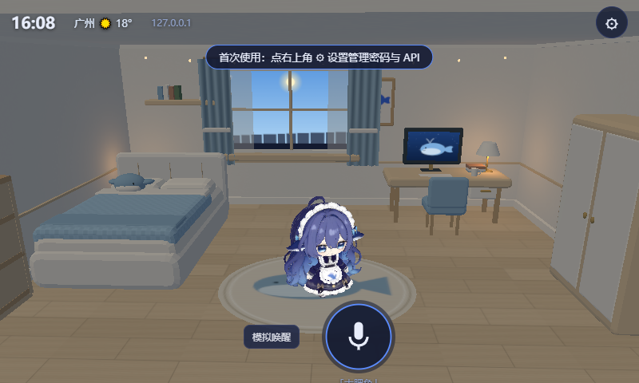
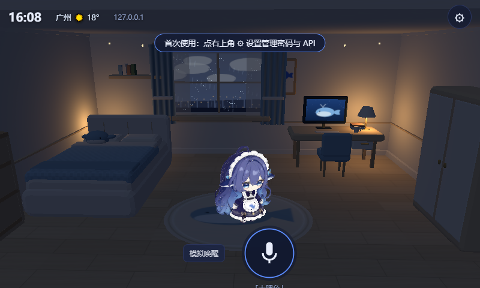
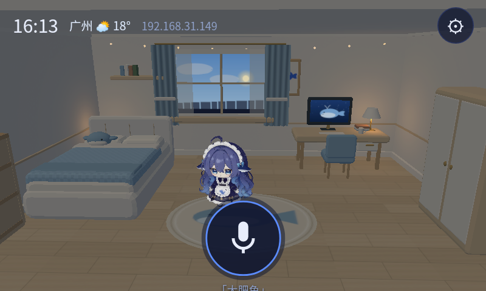

# 素材指南（角色 / 房间 / 降级贴图）

## 当前默认：原创「奶油海盐小屋」

参考用户提供的角色、卧室氛围和 LX04 横屏比例，重新设计为**奶油白墙面、浅橡木、雾蓝织物与琥珀灯光**。
鲸鱼只留在地毯、床头玩偶、屏幕壁纸和小画里，不把整个房间做成海洋主题。保留 8×6 m 的既有动线：左侧床、后墙窗、右侧书桌、中间地毯。左右墙与顶面共用同一墙面材质和昼夜光照，不再露出浅色场景底色。




Web **不加载完整房间 GLB**：`scene/cozyRoom.ts` 用对应低模几何实时构建，首帧即有 Canvas/纯色材质；五张烘焙纹理逐张异步替换。
新房间是默认且唯一的正常选项。旧 `room.ts` 仅在新房间构建抛异常时内部应急接管，不提供旧房间选择器。
当前实测几何 **10,020 triangles / 135 draw calls**（预算 ≤30,000 / ≤150）；八处交互仍为窗户、床、玩偶、显示器、灯、地毯、收音机、绿植。

### 文件与预算

| 产物 | 用途 |
|---|---|
| `tools/assets/blender/dayu_room.blend` | 可编辑母版，贴图已打包；保存时为日光展示状态 |
| `tools/assets/blender/dayu_room_light.glb` | 离线交换/检查模型，不是 Web 运行时房间 |
| `tools/assets/blender/layout.json` | 与 `apps/web/src/scene/roomLayout.ts` 对应的米制布局 |
| `apps/web/public/assets/room/{wood,wall,bedding,rug,curtain}.png` | 五张 512×512 纹理，共 **390,371 bytes**（≤2 MiB） |
| `apps/web/public/assets/room/dayu-{idle,happy}-{0,1}.png` | 四张 320×400 透明调色板立绘，共 **212,758 bytes**（≤512 KiB） |
| `tools/assets/blender/source/`（重建时生成） | 贴图与精灵中间产物；由脚本重建，不提交 Git、不发布到 public |

纹理任意一张失败/超时，其他材质照常替换；立绘任意一帧失败则四帧整组保留 Canvas，避免两种形象混切。
2.5D 背景在运行时从同一房间烘焙，不额外发布整张房间背景；家具点击矩形由真实相机投影生成。

回归同时检查初始 2.5D 的雨雪缓冲与窗框、正常停麦不误报启动失败，以及透明 PNG 的真实 alpha（避免黑底立绘）。optimize_sprites.py 会重新解码校验透明角点；浏览器回归覆盖日光、雨夜、雪夜、唤醒站位、摸头、强制 2.5D 和全部房间图片断载。

## 当前默认：混元 GLB「大肥鱼」（已接入 ✅）
用户用腾讯混元 3D 生成的 Q 版女仆鲸鱼娘雕塑已处理为 `apps/web/public/assets/character.glb`：
- 原始 51MB / 50 万面 / 4096 贴图 → **约 11MB / 14.9 万面 / 2048 贴图**（unlit 手绘风）。
- 加载优先级：**VRM > character.glb > 几何占位形象**；点击摸头、说话蹦跳、思考歪头均已接好。
- 动画为**程序化“纸片人”动画**（无骨骼）：整体呼吸浮动/摇摆 + 头身两段切分（颈部枢轴独立歪头点头）。
  源模型是静态雕塑，没有骨骼与形态键，因此**无法做眨眼/口型/精细表情**——要真表情请走路线 A（VRM）。

### 重建流水线（换模型时重跑）
1. `tools/assets/hunyuan/inspect_glb.py`：解析混元 GLB → mesh_raw.npz + 三张贴图。
2. `tools/assets/hunyuan/decimate_islands.py`：按 UV 岛连通分量分组减面（防跨缝塌缩花脸），
   输出 dec_uvaware.npz（约 9~11 万面，可调 TARGET）。
3. `tools/assets/hunyuan/build_glb.py`：姿态归一化（脸朝 +Z、脚底 y=0、身高 1.35）、
   颈线头身切分（NECK_Y）、法线重算、贴图降采样、手写 GLB。
4. 截图验证：`node tools/e2e-glb-shot.mjs` / `e2e-glb-closeup.mjs` / `e2e-glb-anim.mjs`
   （需 dev server；产物在 docs/preview-glb-*.png）。
依赖：bundled Python + numpy + Pillow + fast-simplification（pip 已装）。

## 路线 A：VRM 正式形象（想要真表情/骨骼动画时推荐）
1. 用 VRoid Studio 按参考图捏「蓝长发 + 女仆裙 + 鲸鱼尾巴」的 Q 版角色
   （尾巴可用自定义发型/饰品部件拼，或导入 Blender 加工）。
2. 导出 VRM 1.0，命名 `character.vrm`，放到 `apps/web/public/assets/character.vrm`。
3. 设备页启动时 HEAD 探测该路径，存在且非 HTML 即自动加载替换占位角色，
   表情（happy）与说话状态已接好。
4. 面数建议 < 3 万、贴图 ≤ 1024，照顾 MT8167 的 GPU。

## 房间与精灵重建（Blender 5.3 已验证）

在项目根目录执行；把 `blender` 换成自己的 Blender 可执行文件路径，Python 环境需有 Pillow：

```powershell
# 先渲染实际 character.glb 的四帧，再压缩为透明调色板 PNG
blender --background --python tools/assets/blender/render_2_5d.py
python tools/assets/blender/optimize_sprites.py

# 雨夜只出图；最后跑日光 --all，保存日光母版并导出交换 GLB
blender --background --python tools/assets/blender/build_room.py -- --mood night --render
blender --background --python tools/assets/blender/build_room.py -- --all
```

`render_2_5d.py` 直接导入项目实际的 `character.glb`，按 **root > body/head** 的局部矩阵制作轻微头身摆动，归一化身高 1.35 m。
它不假设骨骼、尾巴节点或形态键，也不使用代理角色替代。`optimize_sprites.py` 校验尺寸、透明调色板和总大小。
`build_room.py` 的 `--save` 只保存/导出，`--render` 只渲染，`--all` 两者都做；`--mood night` 切换雨夜灯光。
修改家具位置时同步 `layout.json` 与 `roomLayout.ts`，然后重跑测试和浏览器回归。

### 设备比例与离线回归

```powershell
node tools/e2e-cozy-room.mjs
```

脚本自动寻找 Edge/Chrome（可用 `CHROME_PATH` 指定），没有 dev server 时自行启动并在结束后清理。
天气/API 全为确定性 mock，覆盖 800×480 日光、雨夜、雪夜、唤醒站位、摸头、强制 2.5D、全部房间 PNG 失败。
产物为 `docs/screenshots/preview-cozy-*-800x480.png`。桌面 SwiftShader 截图用于视觉/功能验收，**不代表 LX04 真机 FPS**。

### v0.2.0 实机验收

另在 LX04（Android 8.1 / 800×480 / WebView 61）执行了覆盖安装、重启与载入后截图，确认原生桥、内置 Web 包和 3D 房间可用：



这是 ADB 屏幕截图，不是物理相机照片。首次启动需等待实际 GLB 角色载入；modern 包语法报错后由 legacy 包接管属于旧 WebView 的预期兼容路径。此次没有重新验证云端 ASR/LLM/TTS，也没有做持续 FPS 基准测试。

## 路线 C：AI 生成位图
`tools/assets/prompts/imagegen.md` 提供角色概念图、雨夜房间壁纸、鲸鱼地毯的提示词，
可用于海报贴图（poster）、显示器壁纸（whaleWallpaper）与 VRM 贴图参考。

## 美术参考与边界
用户的三张参考图（鲸鱼娘形象 / 雨夜卧室 / LX04 本体）用于角色一致性、温馨氛围和横屏构图，不复制参考房间。
新主色为奶油白 `#f3ead8`、浅橡木 `#ddc39d`、雾蓝 `#91afbf`、琥珀 `#ffc780`；深夜才降低环境亮度，保留台灯附近的暖色层次。
`build_character_proxy.py` 和 `tools/assets/prompts/imagegen.md` 保留作概念/占位工具，不参与当前默认房间与精灵流水线。

