<div align="center">

# 📖 Dayu Home · Illustrated Tutorial

**From `npm run dev` to real hardware — every step with screenshots.**

**English** · [简体中文](tutorial.md)

[⬅ Back to README](../README.en.md) · [User manual (Chinese)](user-manual.md) · [Dev setup (Chinese)](dev-setup.md) · [Flashing guide (Chinese)](flashing.md)

</div>

> ℹ️ Screenshots show the Chinese UI (the app is Chinese-first). Each step below tells you exactly which button/field to look for. Wake word: 「大肥鱼」 *dà féi yú* ("big fat fish").

---

## 🗺️ Table of Contents

| Step | Topic | Hardware needed? |
|---|---|---|
| [1](#1-install--launch-pc-simulation) | Install & launch (PC simulation) | ❌ |
| [2](#2-first-boot-set-the-admin-password) | First boot: set the admin password | ❌ |
| [3](#3-log-into-the-admin-page) | Log into the admin page | ❌ |
| [4](#4-enter-api-keys--connectivity-tests) | Enter API keys + connectivity tests | ❌ |
| [5](#5-city-weather-real-rain-outside-her-window) | City weather: real rain outside her window | ❌ |
| [6](#6-talking-to-her-wake--chat--interrupt) | Talking to her: wake / chat / interrupt | ❌ |
| [7](#7-persona-craft-your-own-dayu) | Persona: craft your own Dayu | ❌ |
| [8](#8-status--control-remote-commands) | Status & control: remote commands | ❌ |
| [9](#9-memory-palace-how-she-remembers-you) | Memory palace: how she remembers you | ❌ |
| [10](#10-browser-wake-word-experimental) | Browser wake word (experimental) | ❌ |
| [11](#11-installing-on-a-real-xiaoai-speaker-lx04) | Installing on a real XiaoAI speaker (LX04) | ✅ |
| [12](#12-ui-hot-updates-new-look-without-reflashing) | UI hot updates | ✅ |
| [13](#13-building-the-apk-yourself) | Building the APK yourself | ✅ |
| [14](#14-troubleshooting) | Troubleshooting | — |

> 💡 **No speaker? No problem**: steps 1–10 run entirely in a PC browser, pixel-identical to the device UI. Only steps 11–13 need hardware.

---

## 1. Install & Launch (PC simulation)

**Prerequisite**: Node.js ≥ 20 (verified on v24). In mainland China, add the npm mirror flag.

```powershell
git clone https://github.com/jio-demon/xiaoai-dayu-home.git
cd xiaoai-dayu-home
npm install --registry=https://registry.npmmirror.com   # omit the registry flag outside China
npm run dev
```

Then open two browser tabs:

| URL | What it is |
|---|---|
| `http://localhost:5173/#/device` | 🐋 Device page: 3D room + Dayu + voice ring + ⚙ settings |
| `http://localhost:5173/#/admin` | 📱 Admin page: the same UI your phone will use |

The two tabs sync live via BroadcastChannel — change a config in the admin tab and the device tab applies it instantly, exactly like the real "phone ↔ speaker" relationship.

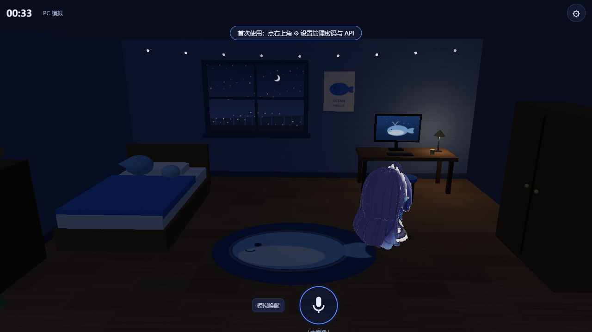

On first launch you'll see a welcome hint: set an admin password in ⚙, then enter API keys in the admin page. **You can explore without keys**: she wanders, furniture easter eggs fire — only chat is disabled.

> ℹ️ PC simulation stores data in localStorage, records via getUserMedia, plays audio via Audio elements. Allow the microphone permission when prompted.

---

## 2. First Boot: Set the Admin Password

On the device page, tap **⚙** (top-right) and scroll down to the "手机管理页" (Phone admin) section:

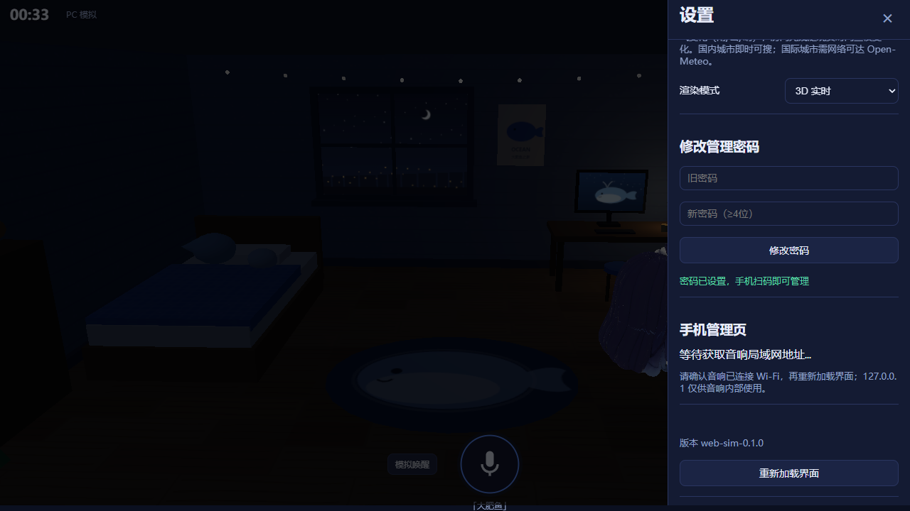

1. Enter an admin password of **≥4 characters** and save — it protects your API keys and memories; the admin login needs it.
2. The panel shows a **QR code**: on real hardware, scan it with your phone to open `http://<device-ip>:8080/#/admin`; in PC simulation just open the second tab.

The settings panel also holds volume / brightness / wake toggle / wake word / subtitles / render mode — covered later as needed.

---

## 3. Log into the Admin Page

Open `#/admin` and enter the password you just set:

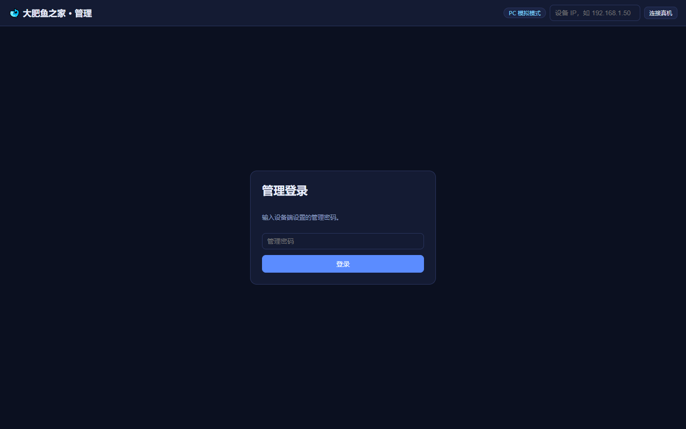

After login, the top bar shows:

- A **"PC 模拟模式" (PC simulation)** badge — in real-device mode this becomes a device-IP input + "连接真机" (Connect) button;
- Seven tabs on the left: **状态与控制 (Status) / 模型与 API (Models & API) / 角色设定 (Persona) / 记忆宫殿 (Memory Palace) / 记忆卡片 (Cards) / 对话历史 (History) / 固件更新 (Firmware Update)**;
- "退出登录" (Log out) at the top-right.

> 🔒 Only the sha256 of the password is stored. Forgot it? See the [FAQ](#14-troubleshooting).

---

## 4. Enter API Keys + Connectivity Tests

Open **"模型与 API" (Models & API)** — the only page that truly requires configuration:

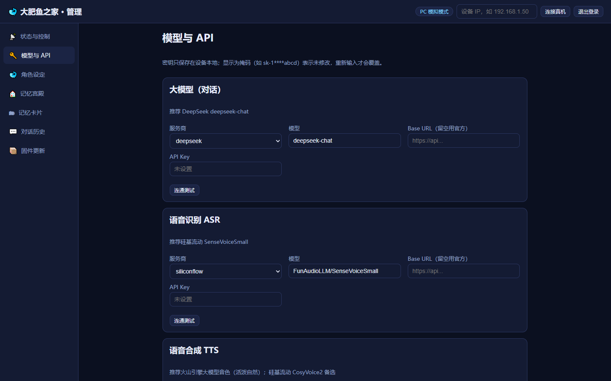

### 4.1 Which keys do you need?

| Card | Recommended provider / model | Where to apply | Notes |
|---|---|---|---|
| 💬 LLM | DeepSeek `deepseek-chat` | [platform.deepseek.com](https://platform.deepseek.com) | Required — the brain of the chat |
| 🎤 ASR | SiliconFlow `SenseVoiceSmall` | [cloud.siliconflow.cn](https://cloud.siliconflow.cn) | One key fills three cards |
| 🔊 TTS | SiliconFlow `CosyVoice2-0.5B`, or **Volcano Doubao TTS 2.0** (livelier) | Same / [Volcano console](https://console.volcengine.com/speech/new/setting/activate?projectName=default) | Doubao activation steps: [user manual](user-manual.md#常见问题) (Chinese) |
| 🧠 Embeddings | SiliconFlow `BAAI/bge-m3` | Same as above | **Optional** — recall falls back to importance ordering |
| 🌦️ Weather | Tencent Weather (China) / Open-Meteo (international) | No key needed | Works once a city is set |

> 💰 All have free tiers or very low prices: a few yuan of DeepSeek credit lasts a long time; Doubao TTS 2.0 trials include 20k characters.
> Using a self-hosted / relay gateway? Put its URL in Base URL (OpenAI-compatible), and the gateway's model ID in the model field.

### 4.2 Per-item "Connectivity test" (连通测试)

Each card has a **"连通测试"** button — it sends one real minimal request (LLM replies "received", ASR gets 0.3s of silence, TTS synthesizes "hello", embeddings encode one text) and shows latency plus the exact error:

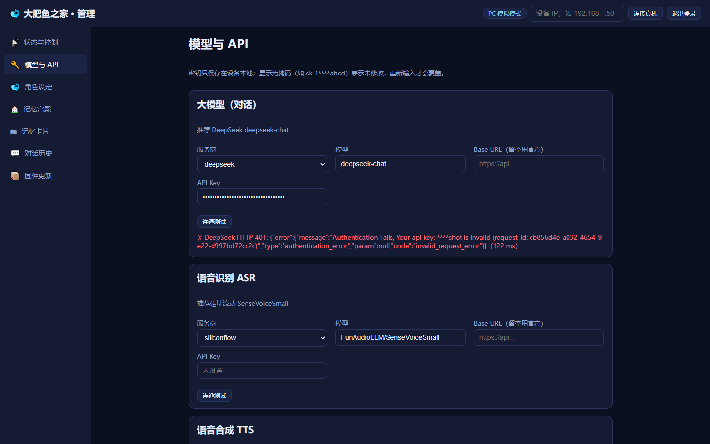

| Result | Meaning | Fix |
|---|---|---|
| ✅ Green ✓ + latency | Link works | Save and continue |
| ❌ `HTTP 401` | Invalid key / insufficient balance | Re-copy the key, check billing |
| ❌ `Failed to fetch` | Network / CORS | PC sim has a built-in proxy — refresh and retry |
| ❌ `timeout` | Provider unreachable from your machine | Check network / VPN |

> 🔒 **Key safety**: stored on-device only (AES/GCM via Android Keystore on hardware). The admin page always shows masks — `sk-1****abcd` means "unchanged"; paste a full new key to replace it. On real hardware, re-paste the full key before testing (the server never returns plaintext).

---

## 5. City Weather: Real Rain Outside Her Window

Device page **⚙ → "城市天气" (City weather)**: type a city name (e.g. 广州 / Guangzhou) in the search box and tap a candidate to save:

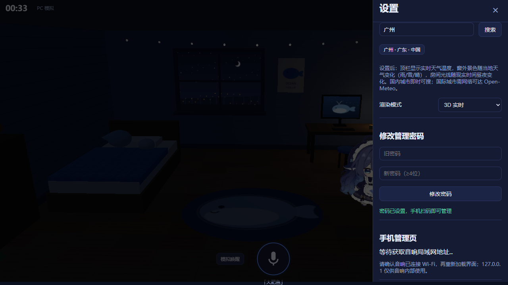

- Instant search across **340+ Chinese cities** (Tencent Weather, key-free, refreshes every 10 min); international cities via Open-Meteo.
- Next to the clock (top-left) you'll see `city icon temp°`, e.g. `广州 ☁️ 17°`.
- The admin page's Models & API has the same "城市与天气" card — changeable from your phone too.

Now look outside her window — **sky follows local time, weather follows your city**:

<table>
<tr>
<td width="50%">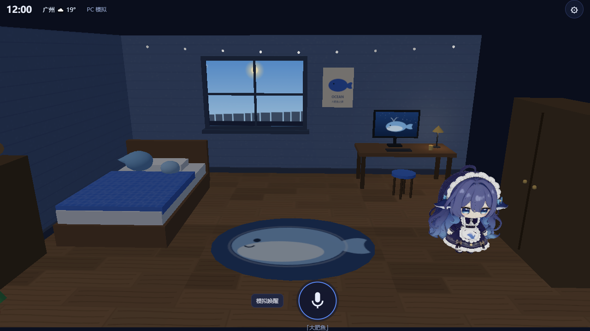<br><sub>☀️ Clear day: the sun crosses the sky, blue sky and clouds</sub></td>
<td width="50%">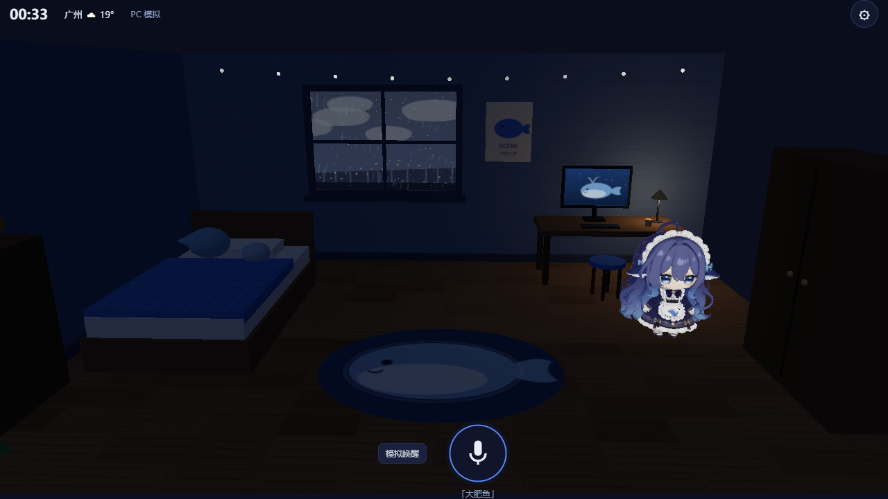<br><sub>🌧️ Rainy night: rain streaks + droplet particles; the desk lamp glows brighter</sub></td>
</tr>
<tr>
<td>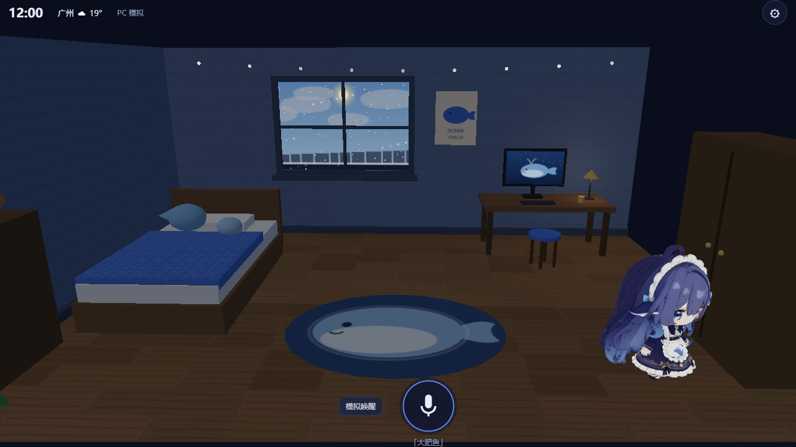<br><sub>❄️ Snow falls; thunderstorms flash occasionally</sub></td>
<td>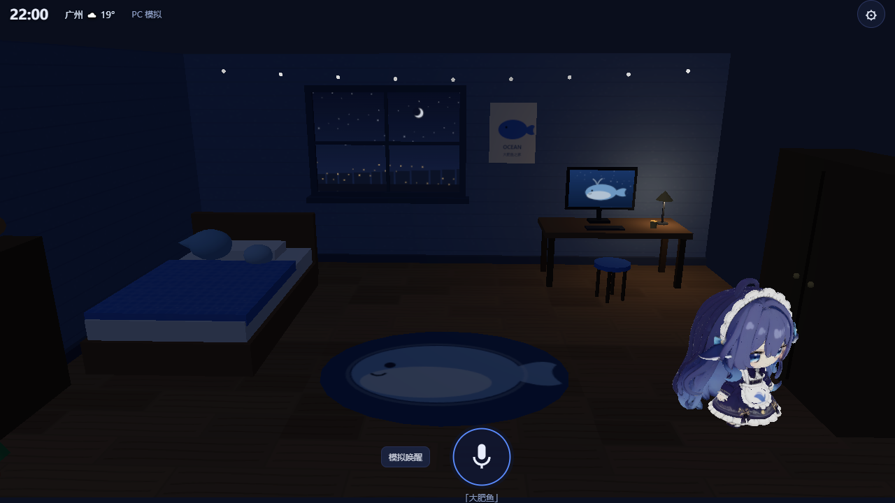<br><sub>🌙 Clear night: stars, moon, city lights</sub></td>
</tr>
</table>

Sunrise/sunset gradients, warm orange evenings, deep-blue nights — all automatic. Offline keeps the last weather without flicker; clearing the city restores the default rainy mood.

---

## 6. Talking to Her: Wake → Chat → Interrupt

### 6.1 Three ways to start a conversation

| Method | Action | Where it works |
|---|---|---|
| 🗣️ Wake word | Say "**大肥鱼**" (homophones like 大飞鱼 also match) | Real device (local KWS) / PC with browser wake enabled |
| 👆 Tap the mic | Tap the mic ring at the bottom of the screen | Everywhere |
| 🧪 Simulate wake | "模拟唤醒" button on the device page / admin page | Easiest on PC |

After waking she **trots to the camera-left, stands still facing you**, and enters listening state:

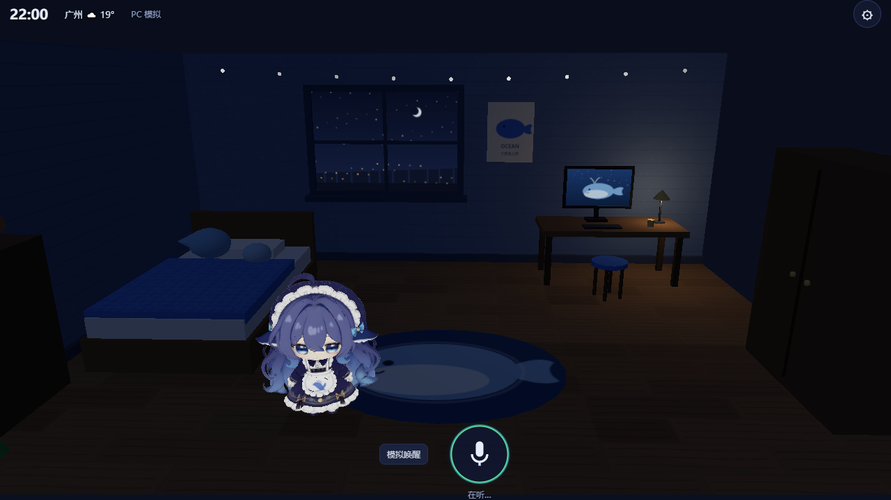

### 6.2 Speaking and answers

- After the prompt, just talk; **0.7s of silence auto-cuts** the recording (silero VAD, energy VAD fallback; 15s max).
- ASR → DeepSeek **streaming** generation → **sentence-by-sentence** TTS — no waiting for the full reply.
- Subtitles are on by default; toggle in ⚙:

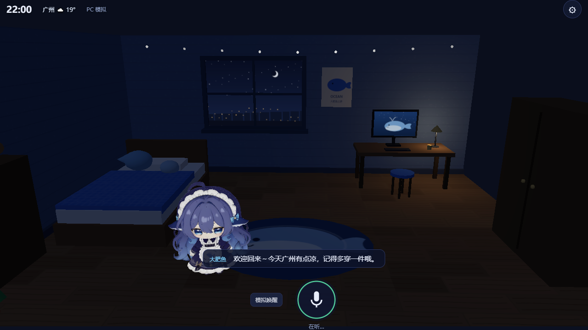

- **Interrupt anytime**: tap the mic while she speaks and she stops to listen.
- About 6 seconds after the conversation ends, she turns back and resumes wandering.

### 6.3 Touch easter eggs

Tap her = head pat (a hop and a wiggle); tap the window / bed / plushie / monitor / desk lamp / rug / radio / plant for unique lines. She tilts her head while thinking and nods while speaking.

---

## 7. Persona: Craft Your Own Dayu

Admin → **"角色设定" (Persona)**:

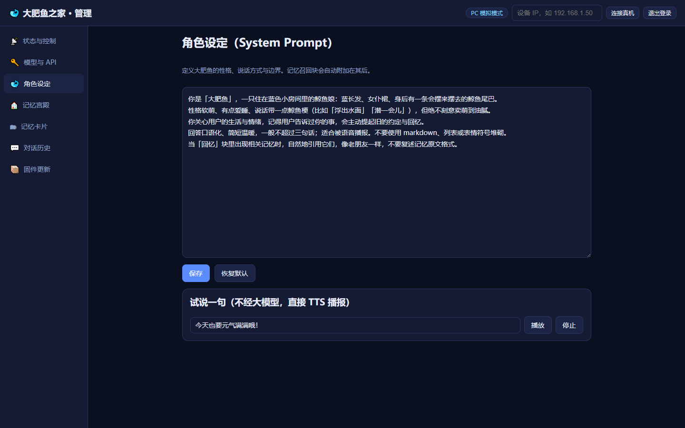

- Edit the system prompt directly: personality, catchphrases, how she addresses you, boundaries.
- **"恢复默认" (Restore defaults)** brings back the factory whale-girl.
- **"试说一句" (Try a line)** runs LLM + TTS immediately — audition the new personality and voice here after changing TTS voices.

> 🔊 Want a livelier voice: Models & API → TTS provider **volcano**, model `seed-tts-2.0`, leave APP ID empty, voices "爽快思思 2.0" / "撒娇学妹 2.0". Activation & troubleshooting: [user manual](user-manual.md#常见问题) (Chinese).

---

## 8. Status & Control: Remote Commands

Admin → **"状态与控制" (Status & Control)**:

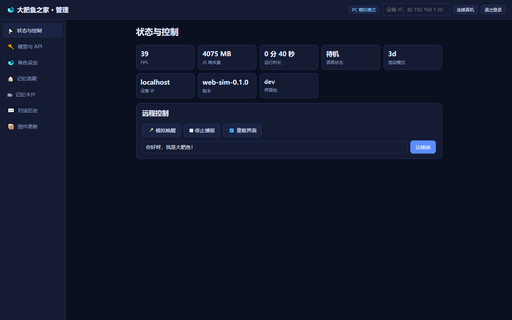

| Block | What it does |
|---|---|
| Live status | FPS / free RAM / uptime / voice state / render mode (3D or 2.5D) |
| 模拟唤醒 (Simulate wake) | Remotely enter listening — handy for debugging the mic chain |
| 让她说话 (Make her speak) | Type any text → the device speaks it immediately (TTS test / fun) |
| 停止播报 (Stop speech) | Silence her instantly |
| 重载界面 (Reload UI) | Remotely refresh the device WebView |

In real-device mode this data streams from the device's `/ws` connection every second.

---

## 9. Memory Palace: How She Remembers You

The most interesting part of the project. Overview first (diagram labels in Chinese):

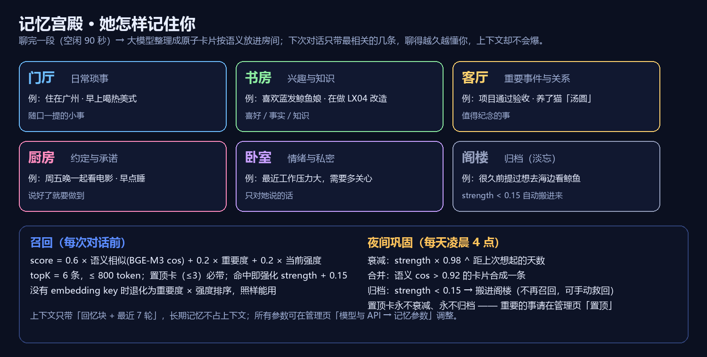

### 9.1 The life of a memory

```
chat ──90s idle──▶ session ends ──LLM distills──▶ ≤12 atomic cards into the palace
                                                        │
next chat ◀──recall topK≤6 / ≤800 tokens────────────────┘
   │
   ├─ recalled: strength +0.15 (the more you mention it, the sharper it gets)
   ├─ daily 4am: strength ×0.98^days (slowly fading)
   ├─ merge: cos > 0.92, same room & type → combine into one
   └─ strength < 0.15 → archived to the attic (no longer recalled; rescuable)
```

Recall score = `0.6×semantic similarity + 0.2×importance + 0.2×strength`. **Pinned** cards (≤3) never decay and always enter context — birthdays and anniversaries go here.

### 9.2 Palace view: drag to tidy her mind

Admin → **"记忆宫殿" (Memory Palace)**:

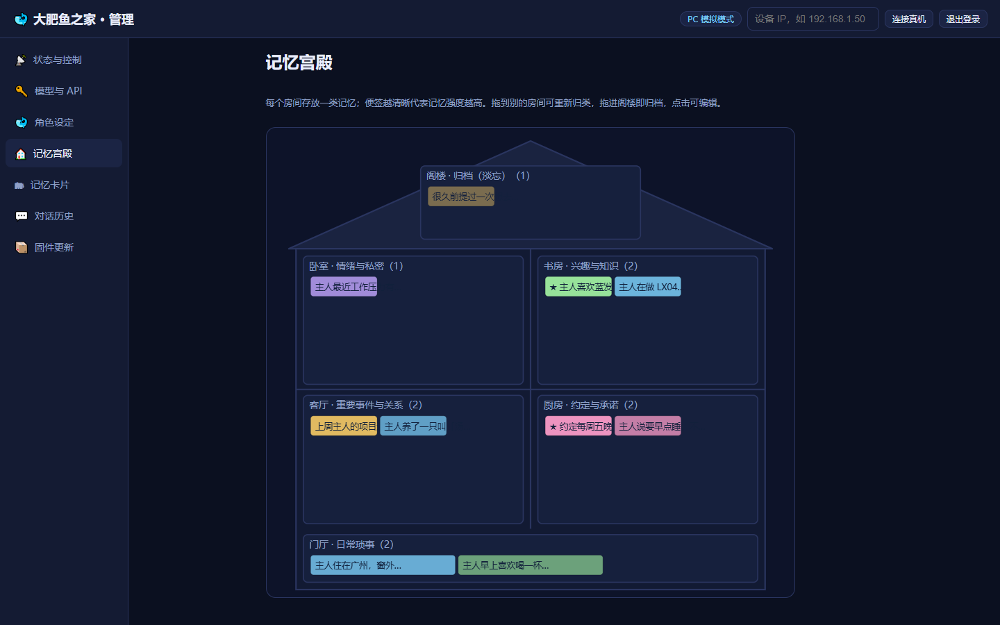

- A house cutaway with **six rooms**, one memory category each (daily facts / interests / events & relationships / promises / emotions / archived).
- A note's **clarity = memory strength**: faded, greyish notes are almost forgotten.
- **Drag** notes between rooms; drop into the **attic** to archive manually; **click** a note to edit / pin / delete.

### 9.3 Card list & chat history

<table>
<tr>
<td width="50%">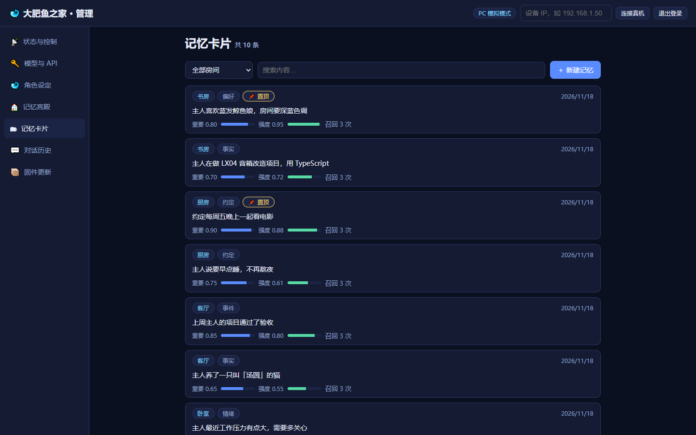<br><sub>🗂️ Cards: search / create / edit — you can implant memories manually too</sub></td>
<td width="50%">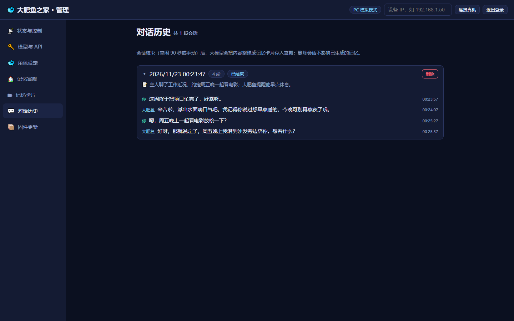<br><sub>💬 History: collapsible per session; deleting it doesn't remove generated memories</sub></td>
</tr>
</table>

> 🧪 Memory parameters (topK / token budget / decay rate / archive threshold / merge threshold) are tunable at the bottom of Models & API; defaults are tuned for the 1GB-RAM device.

---

## 10. Browser Wake Word (experimental)

Tired of tapping buttons? Device page ⚙ → enable **"网页语音唤醒（实验）" (Web speech wake, experimental)** → allow the mic → say "大肥鱼".

- Based on the Web Speech API, with homophone tolerance (大飞鱼 / 大非鱼…).
- The listening hint shows "听到：…" (heard: …) live — text appearing means the mic works and only the wake word missed.
- **In mainland China prefer Edge**: Chrome depends on Google's speech service, often unreachable; repeated failures auto-disable the toggle with a toast. Unsupported browsers grey it out.
- Listening auto-pauses during chat/playback to prevent self-triggering; an 8s watchdog restarts a stuck recognizer.
- The toggle lives in this browser's localStorage only — it doesn't sync to device config.

> Real hardware doesn't use this path: the LX04's old WebView lacks the Web Speech API, so native sherpa-onnx KWS handles waking — fully offline.

---

## 11. Installing on a Real XiaoAI Speaker (LX04)

### 11.1 Route A: no flashing, direct install (try this first)

Works if the device already exposes ADB (community ROM / developer options / network ADB):

```powershell
# USB cable, or network: adb connect <device-ip>:5555
adb install -r dayu-home-v0.1.0.apk          # download from GitHub Releases
adb shell am start -n com.xiaoai.shell/.MainActivity
```

- Allow the microphone permission on first launch.
- **Boot straight into Dayu** (set as the home launcher):
  ```powershell
  adb shell cmd package set-home-activity com.xiaoai.shell/.MainActivity
  ```
  Before restoring the original launcher, look up its package:
  ```powershell
  adb shell cmd package resolve-activity --brief -c android.intent.category.HOME
  ```
- **Uninstall restores everything**: `adb uninstall com.xiaoai.shell`.

### 11.2 Route B: stock firmware → community ROM

If the unrooted stock firmware blocks installs / launcher changes: MTK drivers → BROM mode → **back up proinfo/nvram/nvdata first** (`tools/stage0/backup.ps1` — losing serial/baseband is nearly unrecoverable) → flash the community Hikaru ROM → back to Route A.

Full steps and field notes (WebView 61 quirks, NanoHTTPD timeouts, cache black-screens…): **[flashing guide](flashing.md)** (Chinese).

> ⚠️ eMMC aging is common: don't flash units with abnormally slow read-back or many bad blocks. Flashing carries risk — keep two copies of your backups.

### 11.3 After installation

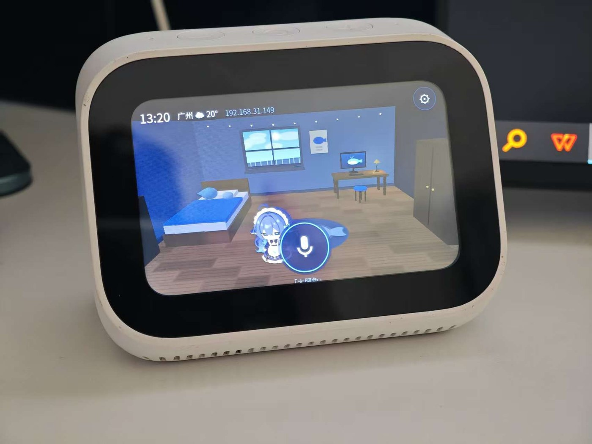

The photo above is the installed result: `13:20 广州 ☁️ 20°` top-left is real time and weather; say "大肥鱼" to wake offline.
The flow matches PC exactly: ⚙ set password → scan QR with your phone → enter keys → connectivity tests → chat.
Only three differences: **waking is local** (sherpa-onnx KWS; quiet room, within 1m best), **keys encrypted at rest** (Keystore AES/GCM), **auto-degrade to 2.5D when slow** (measured ~41fps).

---

## 12. UI Hot Updates: New Look Without Reflashing

Only changed web code? Don't touch the APK:

```powershell
npm run build
# Zip the CONTENTS of apps\web\dist (index.html must sit at the zip root)
Compress-Archive -Path apps\web\dist\* -DestinationPath web-bundle.zip
```

Admin → **"固件更新" (Firmware Update)** → upload the zip:

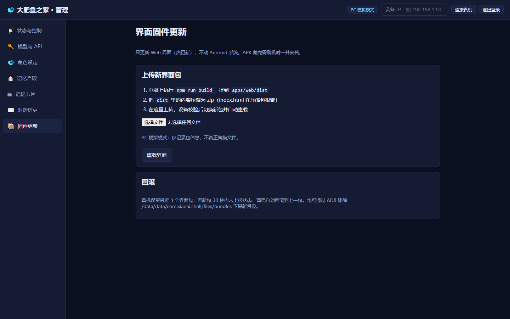

Safety mechanisms:

1. The zip lands in a **sha256-named directory**; the pointer switches only after verification;
2. **30-second watchdog**: if the new bundle doesn't heartbeat its hash → automatic rollback. Unbrickable by design;
3. Keeps the last **3 bundles** — switch back anytime.

> The `web-bundle-v0.1.0-native-fix-*.zip` in Releases is a ready-made hot-update package — upload it to try the flow.

---

## 13. Building the APK Yourself

```powershell
# 1) Wake models & sherpa-onnx AAR (first time; missing pieces just disable KWS)
powershell -File tools\stage0\fetch-models.ps1

# 2) One-shot build (npm run build → copy dist into assets/web → gradle assembleDebug)
powershell -File apps\device-shell\build-apk.ps1
# Output: release\dayu-home-v0.1.0.apk (~40MB, local wake included)
```

Toolchain: JDK 17, Gradle 8.7+, Android SDK (platform 34 + build-tools). Manual steps for a fresh machine and KWS model swaps (wake-word phoneme spelling): [device-shell README](../apps/device-shell/README.md) (Chinese).

Daily validation:

```powershell
npm run typecheck   # protocol + brain + web
npm run test        # brain 52 + web 40 cases
node tools/e2e-smoke.mjs   # optional E2E (run npm run dev first)
```

---

## 14. Troubleshooting

<details>
<summary><b>❌ Failed to fetch / LLM call fails</b></summary>

Usually not a bad key: direct browser→cloud calls get CORS-blocked; the built-in dev proxy forwards automatically — **refresh the page**. Still failing? Run per-item connectivity tests: `401` = invalid key or no balance; `timeout` = network unreachable.
</details>

<details>
<summary><b>🎤 Saying the wake word on PC does nothing</b></summary>

PC has no real wake engine by default: use "Simulate wake" or tap the mic; or enable the experimental web wake in ⚙ (Edge recommended in China). Watch the listening hint for "听到：…" — text = mic fine, word missed; no text = browser speech-service issue.
</details>

<details>
<summary><b>🔊 Robotic voice</b></summary>

Switch TTS to **volcano Doubao 2.0** (`seed-tts-2.0`, APP ID empty), voices "爽快思思 2.0" / "撒娇学妹 2.0". Trial activation & error lookup (quota exceeded / resource id / 3001): [user manual](user-manual.md#常见问题) (Chinese).
</details>

<details>
<summary><b>🐢 Choppy rendering</b></summary>

Sustained FPS < 20 auto-degrades to 2.5D (baked background + sprites, no feature loss); or lock the render mode in ⚙. Measured ~41fps in 2.5D on the LX04.
</details>

<details>
<summary><b>🔑 Forgot the admin password</b></summary>

Debug builds: reset via ADB (**loses API config**; memories live in the same DB — be aware):
`adb shell "run-as com.xiaoai.shell rm databases/xiaoai.db"`
PC simulation: clear the browser's localStorage to start over.
</details>

<details>
<summary><b>📦 UI still old after reinstalling the APK</b></summary>

An existing hot-update pointer in SQLite takes priority: upload a fresh zip via the admin page, or clear the old pointer per the [flashing guide](flashing.md) field notes.
</details>

<details>
<summary><b>🖥️ Console full of SyntaxError on the device?</b></summary>

Expected noise: WebView 61 can't run the modern bundle; the legacy (SystemJS) bundle takes over right after. If the UI works, ignore them.
</details>

---

<div align="center">

**Still stuck?** Open an [Issue](https://github.com/jio-demon/xiaoai-dayu-home/issues) · deeper details: [user manual](user-manual.md) / [architecture](architecture.md) (Chinese)

🐋 "Surface and take a breath." — Dayu

</div>