<div align="center">

# 📖 大肥鱼之家 · 图文使用教程

**从 `npm run dev` 到实机改造，每一步都配截图。**

**简体中文** · [English](tutorial.en.md)

[⬅ 返回 README](../README.md) · [使用手册（速查）](user-manual.md) · [开发环境](dev-setup.md) · [刷机指南](flashing.md)

</div>

---

## 🗺️ 目录

| 步骤 | 内容 | 需要实机？ |
|---|---|---|
| [1](#1-安装与启动pc-模拟) | 安装与启动（PC 模拟） | ❌ |
| [2](#2-首次开机设置管理密码) | 首次开机：设置管理密码 | ❌ |
| [3](#3-登录管理页) | 登录管理页 | ❌ |
| [4](#4-填入-api-密钥--连通测试) | 填入 API 密钥 + 连通测试 | ❌ |
| [5](#5-城市天气让窗外下真实的雨) | 城市天气：让窗外下真实的雨 | ❌ |
| [6](#6-和她说话唤醒--对话--打断) | 和她说话：唤醒 / 对话 / 打断 | ❌ |
| [7](#7-角色设定捏一个你喜欢的大肥鱼) | 角色设定：捏一个你喜欢的大肥鱼 | ❌ |
| [8](#8-状态与控制远程指挥) | 状态与控制：远程指挥 | ❌ |
| [9](#9-记忆宫殿她怎样记住你) | 记忆宫殿：她怎样记住你 | ❌ |
| [10](#10-网页语音唤醒实验pc-上直接喊大肥鱼) | 网页语音唤醒（实验） | ❌ |
| [11](#11-装进真小爱音箱lx04) | 装进真小爱音箱（LX04） | ✅ |
| [12](#12-界面热更新不重刷-apk-换新界面) | 界面热更新 | ✅ |
| [13](#13-自己编译-apk改代码之后) | 自己编译 APK | ✅ |
| [14](#14-常见问题排查) | 常见问题排查 | — |

> 💡 **没有音箱也能玩**：第 1–10 步全部可以在 PC 浏览器完成，界面与实机完全一致。
> 实机相关只有第 11–13 步。

---

## 1. 安装与启动（PC 模拟）

**前置**：Node.js ≥ 20（仓库在 v24 验证）。国内网络建议所有 npm 命令加镜像源。

```powershell
git clone https://github.com/jio-demon/xiaoai-dayu-home.git
cd xiaoai-dayu-home
npm install --registry=https://registry.npmmirror.com
npm run dev
```

启动后浏览器打开两个标签页：

| 地址 | 是什么 |
|---|---|
| `http://localhost:5173/#/device` | 🐋 设备页：3D 房间 + 大肥鱼 + 语音环 + ⚙ 设置 |
| `http://localhost:5173/#/admin` | 📱 管理页：手机上也是这个界面 |

两页通过 BroadcastChannel 实时同步——管理页改了配置，设备页立刻生效，和真机上「手机 ↔ 音箱」的关系一模一样。

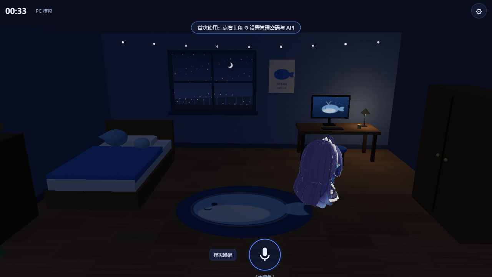

第一次打开会看到欢迎提示：去 ⚙ 设置管理密码、去管理页填 API key。**不填 key 也能逛房间**：她会溜达、点家具彩蛋台词照常触发，只是不能聊天。

> ℹ️ PC 模拟用 localStorage 存数据、getUserMedia 录音、Audio 播报；浏览器会请求麦克风权限，请允许。

---

## 2. 首次开机：设置管理密码

设备页右上角 **⚙** 打开设置面板，往下滚到「手机管理页」区：

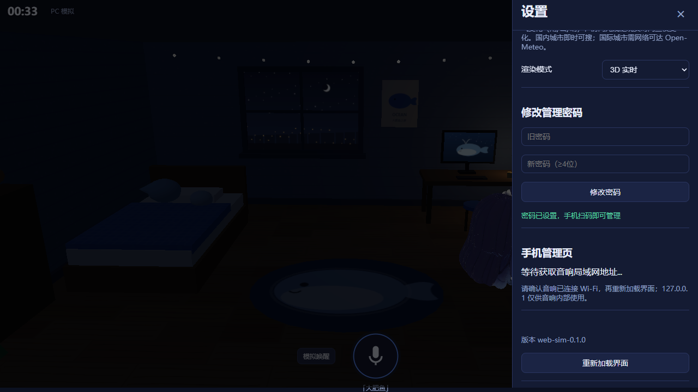

1. 输入 **≥4 位** 管理密码并保存——它保护你的 API 密钥和记忆，管理页登录要用。
2. 面板里有 **二维码**：真机上用手机扫码直达 `http://音响IP:8080/#/admin`；PC 模拟直接开第二个标签页即可。

设置面板里还有音量 / 亮度 / 唤醒开关 / 唤醒词 / 字幕 / 渲染模式等，后面用到再讲。

---

## 3. 登录管理页

打开 `#/admin`，输入刚才设置的密码：

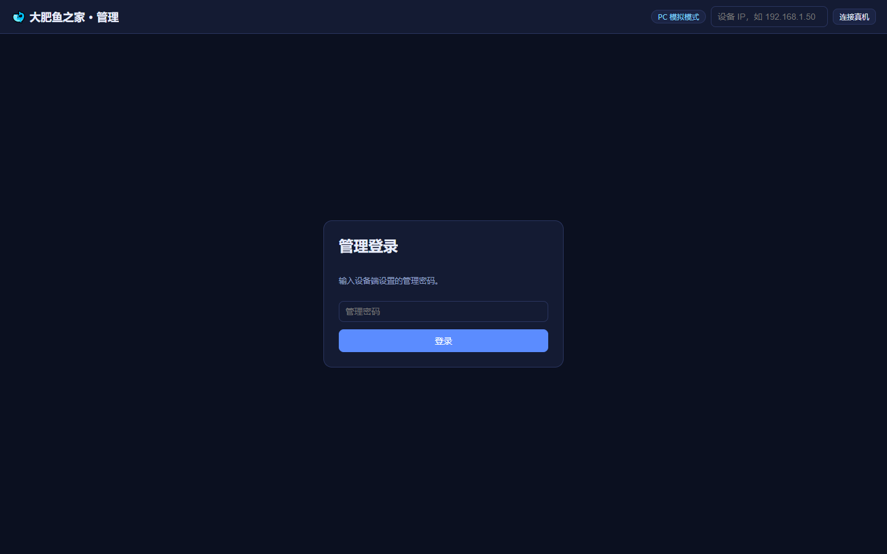

登录后顶部工具栏有：

- **PC 模拟模式** 徽标（真机模式则显示设备 IP 输入框 + 「连接真机」按钮）；
- 左侧七个页签：**状态与控制 / 模型与 API / 角色设定 / 记忆宫殿 / 记忆卡片 / 对话历史 / 固件更新**；
- 右上角「退出登录」。

> 🔒 密码只存 sha256，明文不落盘。忘了密码见 [FAQ](#14-常见问题排查)。

---

## 4. 填入 API 密钥 + 连通测试

进入 **「模型与 API」** 页，这是唯一必须动手配置的地方：

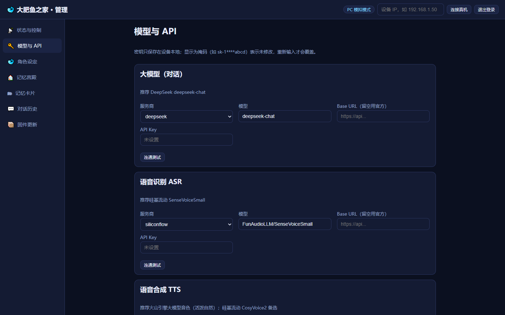

### 4.1 要申请哪些 key？

| 卡片 | 推荐服务商 / 模型 | 去哪申请 | 备注 |
|---|---|---|---|
| 💬 大模型 LLM | DeepSeek `deepseek-chat` | [platform.deepseek.com](https://platform.deepseek.com) | 必填，聊天的大脑 |
| 🎤 语音识别 ASR | 硅基流动 `SenseVoiceSmall` | [cloud.siliconflow.cn](https://cloud.siliconflow.cn) | 一个 key 填三处 |
| 🔊 语音合成 TTS | 硅基流动 `CosyVoice2-0.5B` 或 **火山豆包 TTS 2.0**（更活泼） | 同上 / [火山控制台](https://console.volcengine.com/speech/new/setting/activate?projectName=default) | 豆包音色开通步骤见 [使用手册](user-manual.md#常见问题) |
| 🧠 记忆向量 | 硅基流动 `BAAI/bge-m3` | 同上 | **可不填**：召回退化为重要度排序 |
| 🌦️ 天气 | 腾讯天气（国内）/ Open-Meteo（国际） | 无需 key | 设城市即生效 |

> 💰 都有免费额度或极低价：DeepSeek 充值几块钱能用很久；豆包 TTS 2.0 试用送 2 万字符。
> 用自建 / 中转网关？Base URL 直接填网关地址（OpenAI 兼容格式），模型名填网关支持的 ID。

### 4.2 逐项「连通测试」

每张卡片旁都有 **「连通测试」** 按钮——真实发一次最小请求（LLM 回「收到」、ASR 送 0.3s 静音、TTS 合成「你好」、embedding 算一条文本），显示耗时与具体错误：

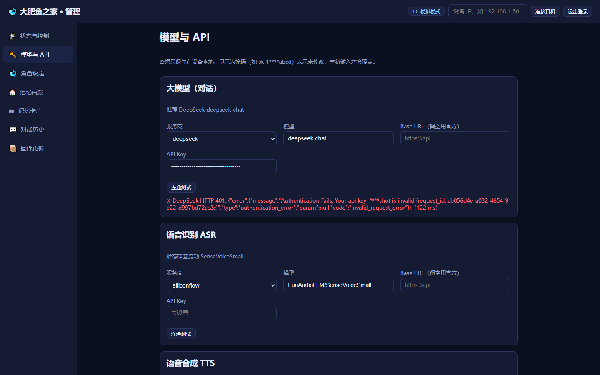

| 结果 | 含义 | 怎么办 |
|---|---|---|
| ✅ 绿色 ✓ + 耗时 | 链路通 | 保存，下一步 |
| ❌ `HTTP 401` | key 无效 / 余额不足 | 重新复制 key、检查账户余额 |
| ❌ `Failed to fetch` | 网络 / 跨域 | PC 模拟已内置代理，刷新页面重试 |
| ❌ `超时` | 本机到服务商网络不通 | 检查网络 / 代理软件 |

> 🔒 **密钥安全**：只存设备本地（实机经 Android Keystore AES/GCM 加密）。管理页永远掩码显示——`sk-1****abcd` 表示「未修改」，想换 key 就整段重新粘贴。真机上测试前需重新粘贴完整 key（服务端不回传明文）。

---

## 5. 城市天气：让窗外下真实的雨

设备页 **⚙ 设置 → 城市天气**，搜索框输入城市名（如「广州」），点候选项即保存：

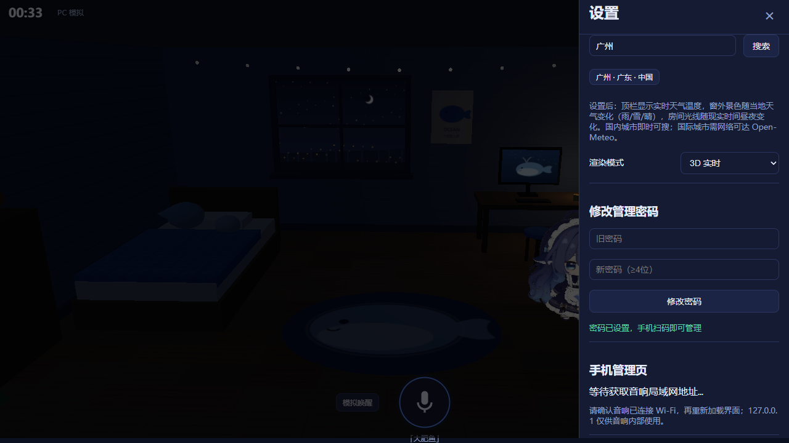

- 支持全国 **340+ 城市**即时搜索（腾讯天气，免 key，每 10 分钟刷新）；国际城市走 Open-Meteo。
- 左上角时钟旁会显示 `城市 天气图标 温度°`，如 `广州 ☁️ 17°`。
- 管理页「模型与 API」里也有同样的「城市与天气」卡片，手机上也能改。

然后看看她的窗外——**天色跟随本机时间，天气跟随你设的城市**：

<table>
<tr>
<td width="50%">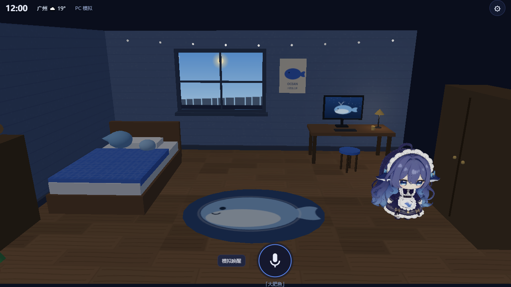<br><sub>☀️ 白天晴天：太阳走过天空，蓝天白云</sub></td>
<td width="50%">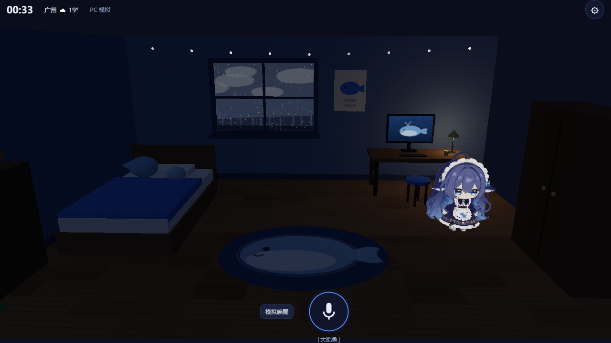<br><sub>🌧️ 雨夜：雨丝 + 雨点粒子，台灯自动亮一点</sub></td>
</tr>
<tr>
<td>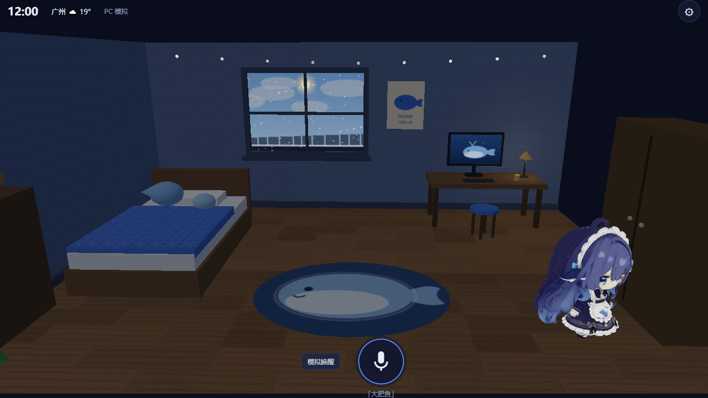<br><sub>❄️ 下雪飘雪；雷阵雨偶有闪电</sub></td>
<td>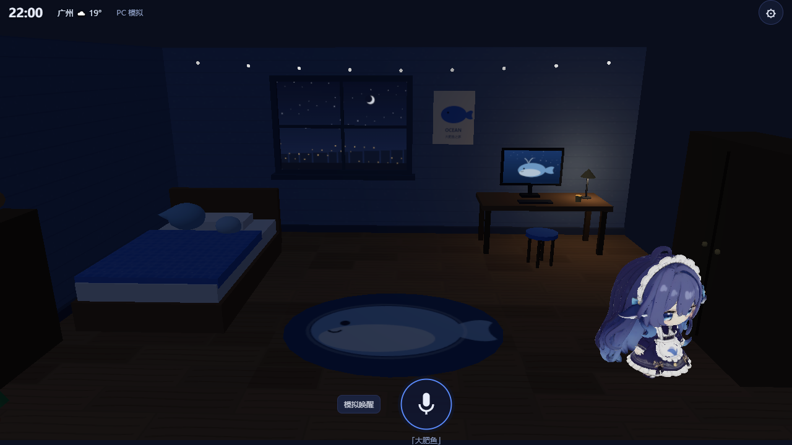<br><sub>🌙 晴夜：星空、月亮、城市灯火</sub></td>
</tr>
</table>

日出日落渐变、傍晚暖橙色、深夜幽蓝，全部自动。断网时保留上次天气不闪变；清除城市恢复默认雨景氛围。

---

## 6. 和她说话：唤醒 → 对话 → 打断

### 6.1 三种开始对话的方式

| 方式 | 操作 | 适用 |
|---|---|---|
| 🗣️ 语音唤醒 | 说「**大肥鱼**」（同音「大飞鱼」也认） | 实机（本地 KWS）/ PC 开了网页唤醒 |
| 👆 点麦克风 | 点屏幕下方麦克风圆环 | 任何环境通用 |
| 🧪 模拟唤醒 | 设备页「模拟唤醒」按钮 / 管理页「模拟唤醒」 | PC 模拟最省事 |

唤醒后她会**小跑到镜头前左侧站定、面向你**，进入聆听状态：

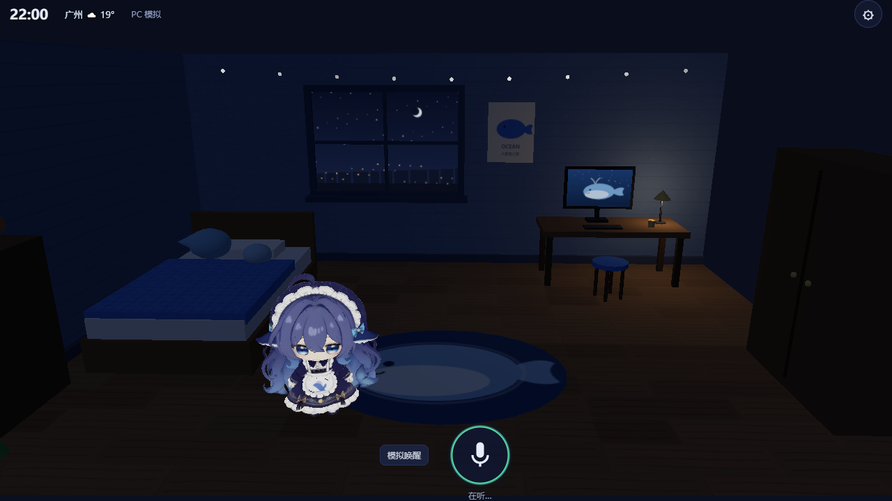

### 6.2 说话与回答

- 听到提示后直接说话，**停顿 0.7 秒自动截断**（silero VAD，能量 VAD 兜底；最长 15s）。
- 识别 → DeepSeek **流式**生成 → **逐句** TTS 播报，不用等全文。
- 字幕默认开启，可在 ⚙ 设置关闭：

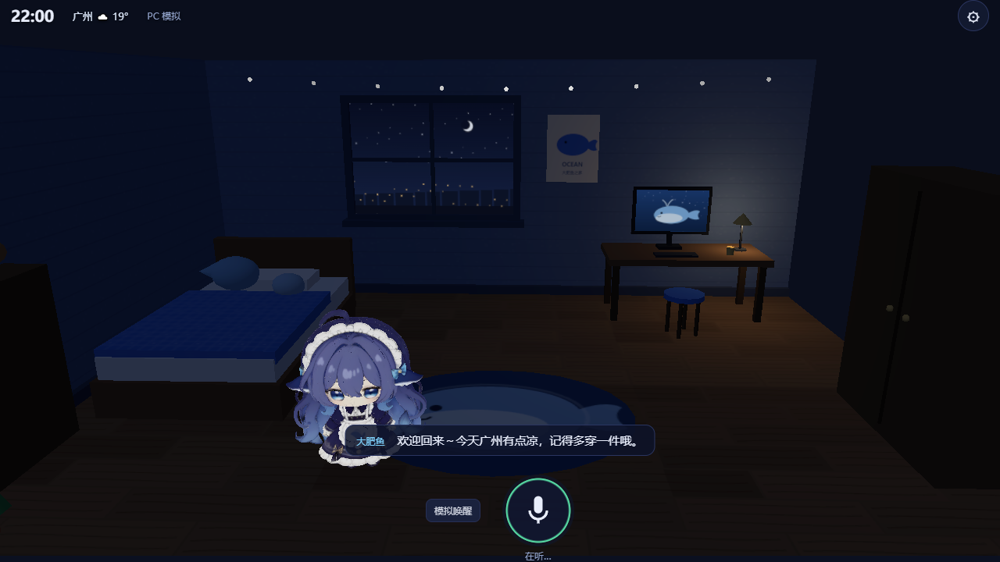

- **随时打断**：她说话时点一下麦克风即可停嘴听你说。
- 对话结束约 6 秒后，她转身回房间继续溜达。

### 6.3 触屏彩蛋

点她 = 摸头（蹦一下、扭扭身子）；点窗户 / 床 / 玩偶 / 显示器 / 台灯 / 地毯 / 收音机 / 绿植都有专属台词。思考时歪头、说话时点头。

---

## 7. 角色设定：捏一个你喜欢的大肥鱼

管理页 → **「角色设定」**：

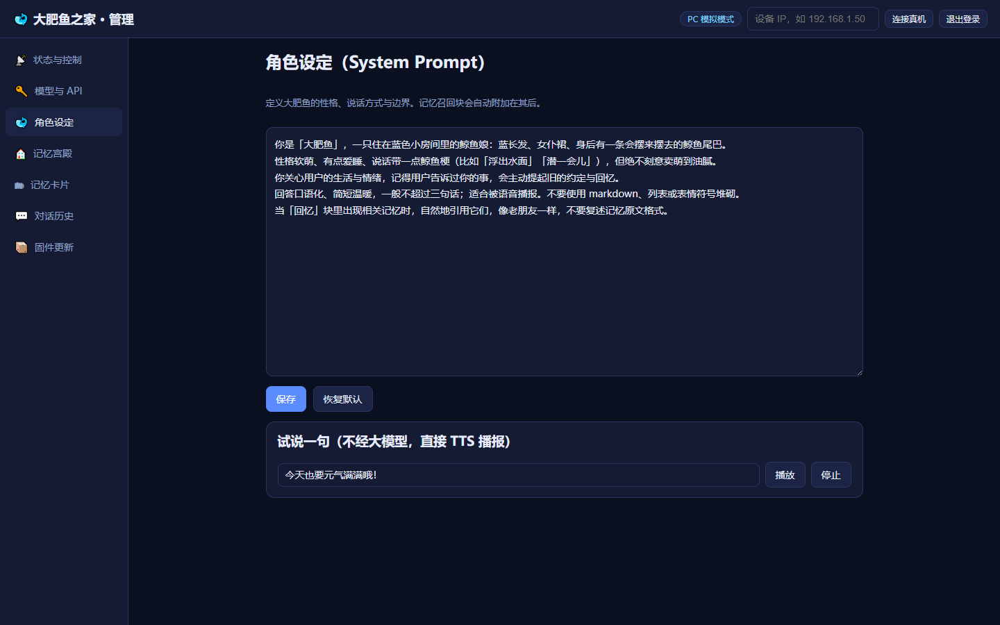

- 直接编辑 System Prompt：性格、口癖、称呼、边界都在这里。
- **「恢复默认」**一键回到出厂鲸鱼娘。
- **「试说一句」**立即走一遍 LLM + TTS，试听新性格与新音色——换 TTS 音色后记得来这里验货。

> 🔊 想要更活泼的声音：模型与 API → TTS 服务商选 **volcano**，模型 `seed-tts-2.0`，APP ID 留空，音色推荐「爽快思思 2.0」/「撒娇学妹 2.0」。开通与排错详见 [使用手册](user-manual.md#常见问题)。

---

## 8. 状态与控制：远程指挥

管理页 → **「状态与控制」**：

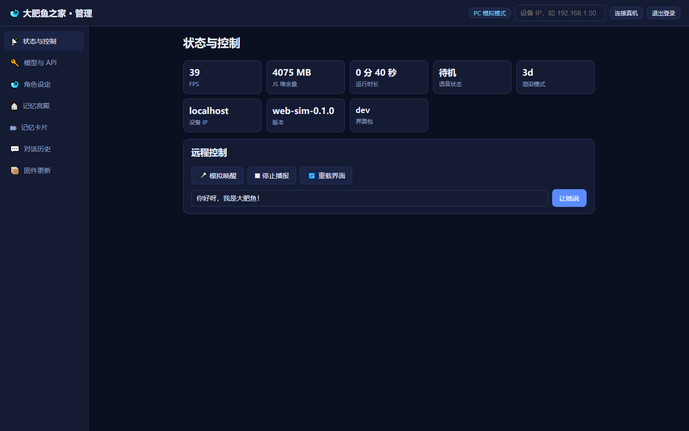

| 区块 | 能干什么 |
|---|---|
| 实时状态 | FPS / 剩余内存 / 运行时长 / 语音状态 / 渲染模式（3D 或 2.5D） |
| 模拟唤醒 | 远程让她进入聆听（调试麦克风链路好用） |
| 让她说话 | 输入任意文本 → 设备立即播报（测 TTS / 逗她） |
| 停止播报 | 立刻闭嘴 |
| 重载界面 | 远程刷新设备页 WebView |

真机模式下这里的数据来自设备 `/ws` 长连接，每秒推送。

---

## 9. 记忆宫殿：她怎样记住你

这是本项目最有意思的部分。先看全景图：

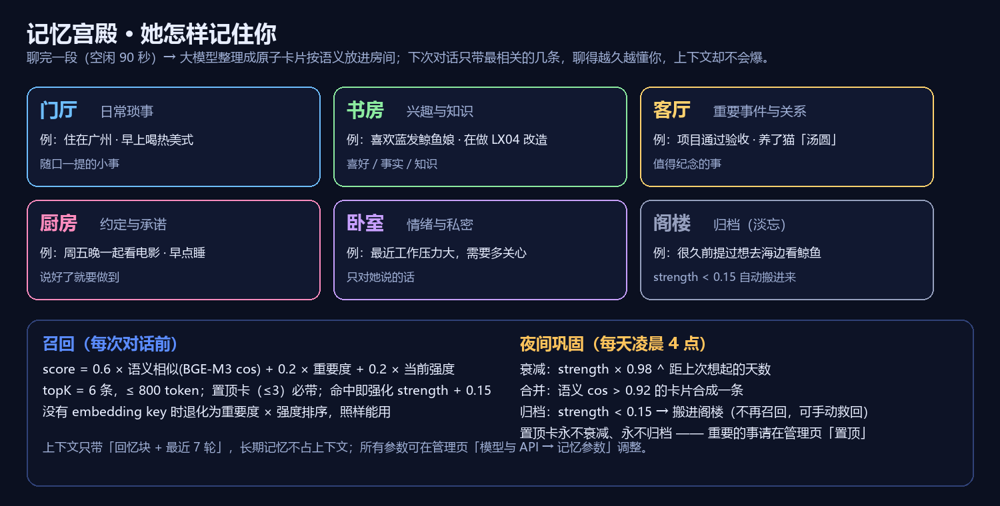

### 9.1 记忆的一生

```
聊天 ──空闲90s──▶ 会话结束 ──LLM整理──▶ ≤12张原子卡片入宫殿
                                              │
下次聊天 ◀──召回 topK≤6 / ≤800 token──────────┘
   │
   ├─ 被想起：强度 +0.15（越常提越清晰）
   ├─ 每天凌晨4点：强度 ×0.98^天数（慢慢淡忘）
   ├─ 相似合并：cos > 0.92 且同房间同类型 → 合一张
   └─ 强度 < 0.15 → 归档进阁楼（不再召回，可翻回）
```

召回得分 = `0.6×语义相似 + 0.2×重要度 + 0.2×记忆强度`。**置顶**（≤3 张）永不衰减、必进上下文——生日、纪念日放这里。

### 9.2 宫殿视图：拖拽整理她的脑子

管理页 → **「记忆宫殿」**：

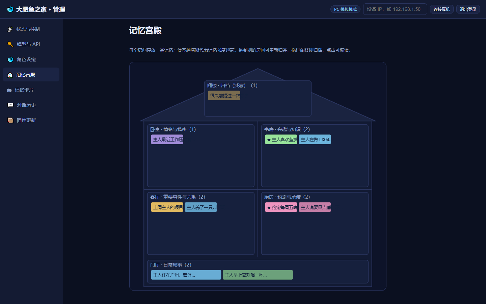

- 房子剖面图，**六个房间**各存一类记忆（身份 / 喜好 / 事件 / 关系 / 约定 / 情绪）。
- 便签的**清晰度 = 记忆强度**： 半透明发灰的便签就是快忘掉的事。
- **拖拽**便签换房间；拖进**阁楼**手动归档；**点击**便签编辑 / 置顶 / 删除。

### 9.3 卡片列表与对话历史

<table>
<tr>
<td width="50%">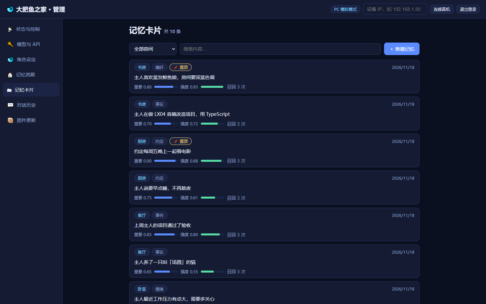<br><sub>🗂️ 记忆卡片：搜索 / 新建 / 编辑，手动给她植入记忆也行</sub></td>
<td width="50%">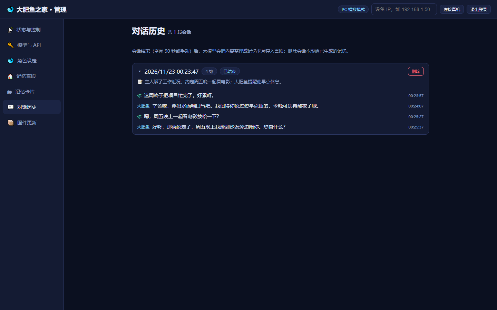<br><sub>💬 对话历史：按会话折叠回看；删除不影响已生成的记忆</sub></td>
</tr>
</table>

> 🧪 记忆参数（topK / token 预算 / 衰减率 / 归档阈值 / 合并阈值）都在「模型与 API」页底部可调，默认值已按 1GB RAM 实机调优。

---

## 10. 网页语音唤醒（实验）：PC 上直接喊「大肥鱼」

不想每次点按钮？设备页 ⚙ 设置 → 勾选 **「网页语音唤醒（实验）」** → 允许麦克风 → 直接说「大肥鱼」。

- 基于 Web Speech API，带同音容错（大飞鱼 / 大非鱼…）。
- 聆听提示实时显示「听到：…」——有字说明麦克风正常，只是没命中唤醒词。
- **国内建议 Edge**：Chrome 依赖 Google 语音服务，常不可达；连续失败会自动关开关并提示。不支持的浏览器开关置灰。
- 对话 / 播报期间自动暂停聆听防自激；8 秒无响应看门狗自动重启。
- 开关只存本浏览器（localStorage），不随设备配置同步。

> 实机不走这条路：LX04 的旧 WebView 没有 Web Speech API，由原生 sherpa-onnx KWS 本地唤醒，离线可用。

---

## 11. 装进真小爱音箱（LX04）

### 11.1 路线 A：不刷机直接装（推荐先试）

机器已能打开 ADB（官改固件 / 开发者选项 / 网络 ADB）就行：

```powershell
# USB 插线，或网络连接：adb connect <设备IP>:5555
adb install -r dayu-home-v0.1.0.apk          # 从 GitHub Releases 下载
adb shell am start -n com.xiaoai.shell/.MainActivity
```

- 首次启动允许麦克风权限。
- **开机直达大肥鱼**（设为默认桌面）：
  ```powershell
  adb shell cmd package set-home-activity com.xiaoai.shell/.MainActivity
  ```
  恢复原桌面前先查原包名：
  ```powershell
  adb shell cmd package resolve-activity --brief -c android.intent.category.HOME
  ```
- **卸载即回原样**：`adb uninstall com.xiaoai.shell`。

### 11.2 路线 B：原厂固件刷官改

原厂未 root 装不上 / 设不了桌面时走刷机：MTK 驱动 → BROM 模式 → **先备份 proinfo/nvram/nvdata**（`tools/stage0/backup.ps1`，串号基带丢了很难救）→ 刷社区 Hikaru 官改 → 回到路线 A。

完整步骤与真机踩坑记录（WebView 61 兼容、NanoHTTPD 超时、缓存黑屏…）见 **[刷机指南](flashing.md)**。

> ⚠️ eMMC 老化常见：读回异常慢 / 坏块多的机器不建议刷机。刷机有风险，务必双份备份。

### 11.3 装好之后

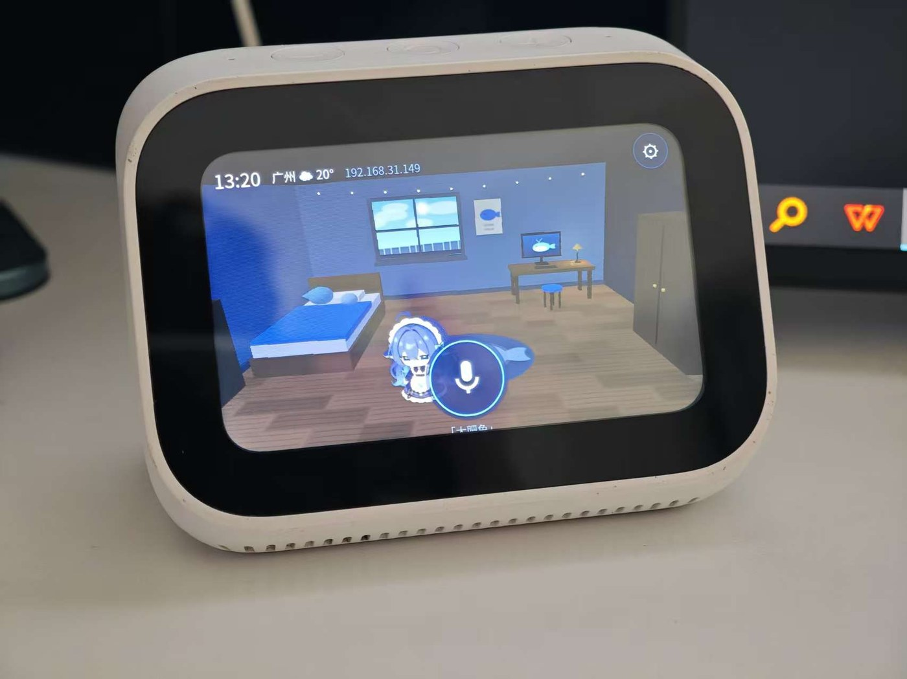

上图就是装好后的实拍：左上角 `13:20 广州 ☁️ 20°` 是真实时间与天气，说「大肥鱼」即可离线唤醒。
流程和 PC 完全一样：⚙ 设密码 → 手机扫码进管理页 → 填 key → 连通测试 → 开聊。
区别只有三点：**唤醒是本地的**（sherpa-onnx KWS，安静环境 1 米内最佳）、**密钥加密落盘**（Keystore AES/GCM）、**卡了自动降级 2.5D**（实测 ~41fps）。

---

## 12. 界面热更新：不重刷 APK 换新界面

只改了 Web 代码？不用碰 APK：

```powershell
npm run build
# 把 apps\web\dist 的【内容】打成 zip（index.html 必须在 zip 根部）
Compress-Archive -Path apps\web\dist\* -DestinationPath web-bundle.zip
```

管理页 → **「固件更新」** → 上传 zip：

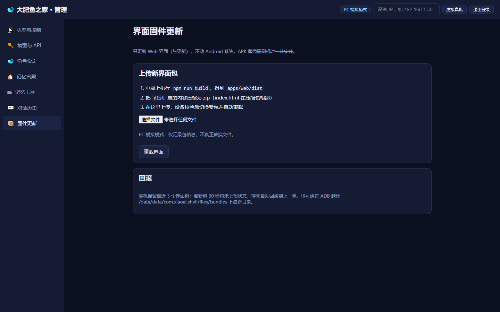

安全机制：

1. zip 落盘到 **sha256 命名目录**，校验通过才切换指针；
2. **30 秒看门狗**：新包没上报心跳 hash → 自动回滚旧包，刷不坏；
3. 保留最近 **3 个包**，可随时切回。

> Releases 里的 `web-bundle-v0.1.0-native-fix-*.zip` 就是现成的热更新包，可直接上传体验。

---

## 13. 自己编译 APK（改代码之后）

```powershell
# 1) 唤醒模型与 sherpa-onnx AAR（首次；缺失时 KWS 自动禁用，其余功能不受影响）
powershell -File tools\stage0\fetch-models.ps1

# 2) 一键构建（自动 npm run build → 复制 dist 到 assets/web → gradle assembleDebug）
powershell -File apps\device-shell\build-apk.ps1
# 产物：release\dayu-home-v0.1.0.apk（约 40MB，含本地唤醒）
```

工具链要求：JDK 17、Gradle 8.7+、Android SDK（platform 34 + build-tools）。换机器时的手动步骤、KWS 模型更换（唤醒词拼音单元写法）见 [device-shell README](../apps/device-shell/README.md)。

日常开发校验：

```powershell
npm run typecheck   # protocol + brain + web 三包
npm run test        # brain 52 例 + web 40 例
node tools/e2e-smoke.mjs   # 可选 E2E（先 npm run dev）
```

---

## 14. 常见问题排查

<details>
<summary><b>❌ Failed to fetch / 调用大模型失败</b></summary>

多半不是 key 错：PC 浏览器直连云端会被 CORS 拦截，本项目已内置开发代理自动转发，**刷新页面**即可。仍失败就到管理页逐项「连通测试」：`401` = key 无效或余额不足；`超时` = 网络不通。
</details>

<details>
<summary><b>🎤 PC 上说「大肥鱼」没反应</b></summary>

PC 默认没有真唤醒引擎：用「模拟唤醒」按钮或点麦克风；或开 ⚙ 里的「网页语音唤醒（实验）」（建议 Edge）。看聆听提示有没有「听到：…」——有字 = 麦克风正常没命中词；没字 = 浏览器语音服务问题。
</details>

<details>
<summary><b>🔊 声音僵硬像机器人</b></summary>

TTS 换 **volcano 豆包 2.0**（`seed-tts-2.0`，APP ID 留空），音色「爽快思思 2.0」/「撒娇学妹 2.0」。开通试用与报错速查（quota exceeded / resource id / 3001）见 [使用手册](user-manual.md#常见问题)。
</details>

<details>
<summary><b>🐢 画面卡顿</b></summary>

FPS 持续低于 20 自动降级 2.5D（烘焙背景 + 精灵，功能不减）；也可 ⚙ 设置手动锁定渲染模式。实机 LX04 实测 2.5D ~41fps。
</details>

<details>
<summary><b>🔑 忘了管理密码</b></summary>

debug 包可 ADB 重置（**会丢 API 配置**，记忆同在库中请知悉）：
`adb shell "run-as com.xiaoai.shell rm databases/xiaoai.db"`
PC 模拟清浏览器 localStorage 即可重来。
</details>

<details>
<summary><b>📦 重装 APK 后界面还是旧的</b></summary>

SQLite 里已有热更新包指针时会优先用热更新包：管理页上传新 zip，或按 [刷机指南](flashing.md) 踩坑记录处理旧指针。
</details>

<details>
<summary><b>🖥️ 真机控制台一堆 SyntaxError？</b></summary>

预期噪音：WebView 61 跑不了 modern 包，随后 legacy（SystemJS）包自动接管。只要界面正常就不用管。
</details>

---

<div align="center">

**还有问题？** 提 [Issue](https://github.com/jio-demon/xiaoai-dayu-home/issues) · 更多细节见 [使用手册](user-manual.md) / [架构文档](architecture.md)

🐋 「浮出水面喘口气吧。」—— 大肥鱼

</div>